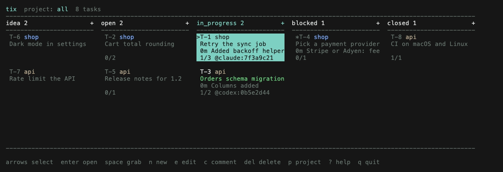

# tix

Markdown tasks under git for AI coding agents, each edit linked to its session.

[](https://github.com/daniil4545/tix/actions/workflows/ci.yml)
[](https://github.com/daniil4545/tix/releases)
[](LICENSE)



`tix` keeps tasks as markdown files in one folder, `~/tasks`, under git. Agents
(Claude Code, Codex) work through the `tix` command: tix is their memory
between sessions. The terminal board is your dashboard: you watch the work, move
cards, comment and edit, with keys or the mouse, or read the files in Obsidian.
An agent logs a short note on every step: a decision, a commit, a PR. A task
that needs you goes to `blocked` with the reason, and the board marks it with
`*`. Every edit is
one git commit that names the agent session, and the model, that made it. A
change always leads back to the conversation behind it. Your comments on a task
reach the agent that holds it.

Status: pre-1.0, the file format may still change before 1.0.

## Features

| What | In one line |
| --- | --- |
| One store for all projects | a single `~/tasks` folder, the project is the folder name above `.git` |
| Plain files | one `.md` file per task, readable by agents, Obsidian and `grep` |
| Session in every commit | each edit is a commit with `Actor:` holding the full session id, plus `Model:` and `Code:` trailers |
| Safe writes | lock, temporary file, rename; an unparsable file is never overwritten |
| Edits outside `tix` survive | a change made in Obsidian is committed by the next operation |
| Claim | `tix take` claims a task for 3 hours; another session needs `--steal` |
| Short brief | `tix ctx` prints the in_progress, blocked and open tasks of the project in under 2000 characters; outside a project, in_progress and blocked tasks and counts of the rest |
| Comments reach the agent | a hook hands your new comments to the agent that holds the task |
| Five statuses | `idea`, `open`, `in_progress`, `blocked`, `closed`; an epic is a task with a todo list that `tix` ticks |
| Board | `tix` without arguments opens a terminal board: keys, mouse, drag between columns |
| History | the store is a git repository: `git -C ~/tasks log` and `git -C ~/tasks revert` restore any task |

## Install

Needs Go 1.27.2 or newer for `go install`, and git at run time.

```sh
go install github.com/daniil4545/tix/cmd/tix@latest
```

Or take a macOS or Linux archive (amd64, arm64) from the
[releases](https://github.com/daniil4545/tix/releases), check it against
`SHA256SUMS.txt` and put `tix` on your PATH. Windows is not supported.

`tix --version` prints the release number for an archive and `dev` for a
`go install` build.

## Quick start

1. Create a task from a project folder (the one with `.git`):

   ```sh
   tix new "Add retry to the sync job"
   ```

   ```text
   ok T-1 idea
   ```

2. Give it done criteria, then move it to `open`. Criteria are `- [ ]` lines
   under `## Details`. `tix edit` reads the new body from stdin and needs the
   revision that `tix show` prints:

   ```sh
   printf '## Details\n- [ ] Failed sync retries 3 times\n' | tix edit 1 --base "$(tix show 1 --json | jq -r .rev)"
   tix move 1 open
   ```

   ```text
   ok T-1 edit
   ok T-1 idea > open
   ```

   The statuses are `idea`, `open`, `in_progress`, `blocked`, `closed`.

3. An agent takes it, logs a step and ticks the criterion:

   ```sh
   tix take 1 --as claude:demo
   tix note 1 "Added backoff helper"
   tix check 1 1
   tix done 1 -m "Retries with backoff"
   ```

   ```text
   ok T-1 open > in_progress  @claude:demo until 17:30
   ok T-1 note
   ok T-1 1/1
   ok T-1 in_progress > closed
   ```

4. Open the board with `tix`, or list tasks with `tix list`.

`tix ctx` is what an agent reads at the start of a session. It names the
project, how to work, and the tasks that need attention:

```text
project shop   rules: ~/tasks/RULES.md
- take: tix take; step: tix note; end: tix done
open T-1 Add retry to the sync job | 0/1
next T-1
```

The same flow in motion: an agent takes a task and logs a step, then the board
and the task card with its history.


## More

- [docs/commands.md](docs/commands.md): every command, exit codes, statuses, board keys, settings.
- [docs/how-it-works.md](docs/how-it-works.md): connect Claude Code and Codex, what git records, design, comparison.
- [docs/architecture.md](docs/architecture.md): map of the packages.

## Development

Checks: `make lint`

```sh
make lint     # all static checks
make check    # lint, tests, build
make bench    # speed on 1000 tasks
```

See [CHANGELOG.md](CHANGELOG.md) for releases.

## License

[MIT](LICENSE)
