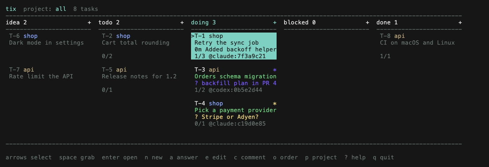
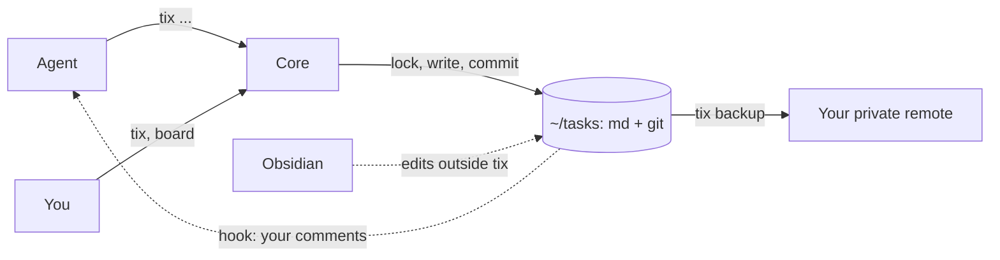

# tix

Markdown tasks under git for AI coding agents, each edit linked to its session.

[](https://github.com/daniil4545/tix/actions/workflows/ci.yml)
[](https://github.com/daniil4545/tix/releases)
[](LICENSE)



`tix` keeps tasks as markdown files in one folder, `~/tasks`, under git. Agents
(Claude Code, Codex) work through the `tix` command. You watch and steer the
work on a terminal board, with keys or the mouse, or in Obsidian. Every edit is
one git commit that names the agent session, and the model, that made it. A
change always leads back to the conversation behind it. Your comments on a task
reach the agent that holds it.

Status: version 0.1, the file format may still change before 1.0.

## Features

| What | In one line |
|---|---|
| One store for all projects | a single `~/tasks` folder, the project is the folder name above `.git` |
| Plain files | one `.md` file per task, readable by agents, Obsidian and `grep` |
| Session in every commit | each edit is a commit with `Actor:` holding the full session id, plus `Model:` and `Code:` trailers |
| Safe writes | lock, temporary file, rename; an unparsable file is never overwritten |
| Edits outside `tix` survive | a change made in Obsidian is committed by the next operation |
| Claim | `tix take` claims a task for 3 hours; another session needs `--steal` |
| Short brief | `tix ctx` prints the active, waiting and ready tasks in under 2000 characters |
| Comments reach the agent | a hook hands your new comments to the agent that holds the task |
| Board | `tix` without arguments opens a terminal board: keys, mouse, drag between columns |

## Install

Needs Go 1.27.2 or newer for `go install`, and git at run time.

```sh
go install github.com/daniil4545/tix/cmd/tix@latest
```

Or take a macOS or Linux archive (amd64, arm64) from the
[releases](https://github.com/daniil4545/tix/releases), check it against
`SHA256SUMS.txt` and put `tix` on your PATH. Windows is not supported.

`tix --version` prints the release number for an archive and `dev` for a
`go install` build.

## Quick start

1. Create a task from a project folder (the one with `.git`):

   ```sh
   tix new "Add retry to the sync job"
   ```

   ```text
   ok T-1 idea
   ```

2. Give it done criteria, then move it to `todo`. Criteria are `- [ ]` lines
   under `## Details`. `tix edit` reads the new body from stdin and needs the
   revision that `tix show` prints:

   ```sh
   printf '## Details\n- [ ] Failed sync retries 3 times\n' | tix edit 1 --base "$(tix show 1 --json | jq -r .rev)"
   tix move 1 ready
   ```

   ```text
   ok T-1 edit
   ok T-1 idea > todo
   ```

   `move` accepts a column name (`todo`) or a column role (`ready`).

3. An agent takes it, logs a step and ticks the criterion:

   ```sh
   tix take 1 --as claude:demo
   tix note 1 "Added backoff helper"
   tix check 1 1
   tix done 1 -m "Retries with backoff"
   ```

   ```text
   ok T-1 todo > doing  @claude:demo until 17:30
   ok T-1 note
   ok T-1 1/1
   ok T-1 doing > done
   ```

4. Open the board with `tix`, or list tasks with `tix list`.

`tix ctx` is what an agent reads at the start of a session. It names the
project, how to work, what each column means and the tasks that need attention:

```text
project shop   rules: ~/tasks/RULES.md
- take: tix take; step: tix note; end: tix set summary=
- columns: idea=inbox todo=ready doing=active blocked=waiting done=closed
todo T-1 Add retry to the sync job | 0/1
next T-1
```

The same flow in motion: an agent takes a task and logs a step, then the board
and the task card with its history.


## Commands

| Command | What it does |
|---|---|
| `tix new "title" [--to column] [--project p]` | creates a task, by default in the `inbox` column; a column that needs criteria or a reason is refused |
| `tix list [--project p] [--status s] [--json]` | lists tasks |
| `tix show T-12 [--json]` | prints the whole task with its `rev` |
| `tix edit T-12 --base <rev>` | replaces the body from stdin; comments stay untouched |
| `tix comment T-12 "text"` | adds a comment |
| `tix note T-12 "text"` | logs a step in the history |
| `tix rm T-12` | deletes a task |
| `tix ctx [--project p] [--json]` | brief of the project: active, waiting, ready, next task |
| `tix take T-12 [--steal\|--release]` | claims a task for 3 hours, takes it over, or releases it back to ready |
| `tix move T-12 <column or role> [--first\|--after T-9] [-m text] [--force]` | moves a task; checks on entering `ready`, `waiting`, `closed` |
| `tix set T-12 field=value...` | sets `title`, `project`, `waiting`, `due`, `tags`, `ask`, `external`, `abstract`, `summary` |
| `tix check T-12 1 2` | ticks criteria by number |
| `tix done T-12 [-m text] [--force]` | closes a task, drops the claim and clears `ask` |
| `tix backup` | commits edits made outside `tix` and pushes `HEAD` to `origin` |
| `tix inbox --hook` | delivers new comments to an agent; runs from a hook, not by hand |

An id works with or without the prefix: `12` means `T-12`. Every command takes
`--as <name>` for the actor and `-v` to print the commit hash. Without `--as`
the name comes from `CLAUDE_CODE_SESSION_ID`, `CODEX_THREAD_ID` or `TIX_ACTOR`.
When both agent variables are set (one agent started inside another), a write
asks for `--as`.
Text that starts with a dash goes after `--`.

Exit codes: 0 success, 1 other error, 2 busy, 3 conflict, 4 no such task,
5 rule refused, 6 bad input.

Columns and their roles live in `~/tasks/.tix/config.toml`. The defaults:

| Column | Role | Rule on entering |
|---|---|---|
| `idea` | inbox | none |
| `todo` | ready | at least one criterion |
| `doing` | active | none |
| `blocked` | waiting | needs the `waiting` field, `-m "reason"` sets it |
| `done` | closed | all criteria ticked, or `--force -m "result"` |

The same file has a `[projects]` table to rename a project folder.

### Board

`tix` without arguments opens the board in a terminal. Columns show cards with
the title, the project and a one-line pulse. The board refreshes when a file in
`~/tasks` changes, so an agent's work appears live. Color shows who is on a
task: the title is green while an agent holds a live claim, and the whole card
is grey when nobody does. A `*` appears only when a live agent waits for you:
its `ask` field holds a question, yellow for a decision, blue for a review
(`ask="review: ..."`), red for access such as a key or a login
(`ask="access: ..."`). A card without a live claim has no star: the answer stays
in the task for the next agent. A due date in the past is red, and each project
label has its own muted color.

| Keys | Action |
|---|---|
| `h j k l`, arrows | select a column and a card |
| `space` | grab the card; arrows move it, `space` or `enter` drops it, `esc` cancels |
| `enter` | open the card |
| `n` | new task in the selected column (in the inbox column if that column needs criteria): asks for a title, then opens `$EDITOR` |
| `a` | answer the agent's question |
| `e`, `c` | edit the body in `$VISUAL` or `$EDITOR`, add a comment |
| `g` | go to the agent's session (macOS and Warp only) |
| `o`, `p` | order by due date or rank, cycle the project filter |
| `J`, `K` | move the card down or up in its column |
| `delete` | delete the task, asks `y/n` |
| `?`, `q` | help, quit |

In a card, `j` and `k` step through the history, `enter` unfolds an entry or
toggles a criterion, `h` and `l` open the previous or next task of the column,
`f` edits one field (title, due, tags, ask, waiting, summary, external) and
`esc` goes back.

The mouse does the same. Click a card to select it and double click to open
it. Drag a card to another column to move it. Click `+` in a column name for a
new task. The wheel scrolls. The hint line and the card actions line are
buttons.

A drop or a drag goes through the same checks as `tix move`. A refusal, for
example moving a task without criteria to `todo`, shows in the status line.

## Connect your agents

`scripts/connect.sh` wires Claude Code and Codex to `tix` once. It needs bash,
`jq` and `tix` on the PATH, and runs from a clone of this repository.

```sh
scripts/connect.sh plan     # prints what apply would change, writes nothing
scripts/connect.sh apply    # adds what is missing, records it in a manifest
scripts/connect.sh undo     # removes only what the manifest lists
```

Options: `--agent claude|codex|all`, `--force` to overwrite a changed file of
ours. Backups `<file>.tix-bak-<time>` live only while `apply` runs. If it
fails, they stay and the script names them. Start a new agent session
afterwards.

| File | What is added | Agent |
|---|---|---|
| `~/.claude/settings.json` | hooks, see below; permission `Bash(tix *)` | Claude Code |
| `~/.claude/skills/tix/` | the `tix` skill | Claude Code |
| `~/.codex/hooks.json` | hooks, see below | Codex |
| `~/.codex/rules/tix.rules` | rule that allows `tix` | Codex |
| `~/.agents/skills/tix/` | the `tix` skill | Codex |
| `~/tasks/.tix/connect-state.json` | manifest used by `undo` | both |

Hooks:

| Event | Command | Why |
|---|---|---|
| `SessionStart` | `tix ctx --hook` (Claude Code), `tix ctx` (Codex) | the brief opens the session; for Claude Code the hook also records the model |
| `PostToolUse`, `UserPromptSubmit` | `tix inbox --hook` | add new comments on the agent's tasks to its context |
| `Stop` | `tix inbox --hook` | if you left a comment meanwhile, return the agent to work |

A comment is delivered once, only to the session that holds the task. A comment
by `human` also wakes an idle agent. A comment by another agent waits for the
next tool call or prompt, so two agents do not answer each other in circles.

`CLAUDE.md` and `AGENTS.md` are not touched. Codex asks you to trust new hooks:
open `/hooks` in Codex and confirm `tix inbox --hook`. The skill tells agents to
run `tix` as a single command, without `;`, `&&`, pipes or `cd`, so the Codex
rule can match it.

Example phrases that work with the skill:

- "What is next on this project?" runs `tix ctx`.
- "Write this down for later: retry the upload" runs `tix new`.
- "Take T-12 and finish it" runs `take`, `note`, `check`, `done`.

### What git records

```text
T-2: note x

Actor: claude:5f0c2e1a-9d3b-4c7e-8a41-2b6d7e9f0a13
Code: shop@c20e104ab4563c7c9e254d67dec4890f8ab3f043
Model: claude-opus-4-7
```

`Actor` is the agent session, `human` for the board, or `external` for an edit
made outside `tix`. `Code` is the project and its `HEAD` at the time. `Model`
comes from `TIX_MODEL`. The Claude Code hook sets it for the session. For other
agents, export `TIX_MODEL` yourself. The trailer is skipped when the variable is
empty or has odd characters.

## Configuration

All variables are optional.

| Variable | What it sets |
|---|---|
| `TIX_HOME` | task folder, default `~/tasks` |
| `TIX_LOCK_TIMEOUT` | wait for the write lock, a Go duration, default `5s` |
| `TIX_GIT` | path to git, skips the search and the cache |
| `TIX_ACTOR` | actor name when no agent session id is set |
| `TIX_MODEL` | model name for the `Model:` trailer |
| `VISUAL`, `EDITOR` | editor for the board, `vi` if both are empty |

`tix` writes only inside the task folder. Service files live in
`~/tasks/.tix`. Small per-user state (delivery marks, tab addresses) lives in
the user cache folder under `tix/`. The only network call is the `git push` of
`tix backup`.

## How it works



One binary, no daemon: a process starts for a command and exits. All writes go
through one core path, so two agents and a human can write to the same folder
without losing edits. `edit` with `--base` merges a stale body instead of
overwriting a newer one. The map of packages is in
[docs/architecture.md](docs/architecture.md).

<details>
<summary>Why a commit per edit?</summary>

The commit carries the session id of the agent, so `git log` shows which
conversation changed a task and when. Edits made outside `tix` are committed by
the next operation as an external edit.
</details>

<details>
<summary>Can I use it without an agent?</summary>

Yes. The files are plain markdown, and the board and `tix` work from any
terminal.
</details>

<details>
<summary>How do I back it up?</summary>

Add a private remote named `origin` in `~/tasks` and run `tix backup`.
</details>

## Comparison

State as of Oct 2026, from the READMEs and GitHub pages of the projects.

| Project | Storage | Writes | Notes |
|---|---|---|---|
| tix (this) | md files in one folder, git | lock, commit per edit with session id | local, no server |
| [Backlog.md](https://github.com/MrLesk/Backlog.md) | md in each repository | files | board in the web, MCP |
| [Beads](https://github.com/gastownhall/beads) | Dolt database | database | `ready`, `prime`, claim; no md files |
| [wedow/ticket](https://github.com/wedow/ticket) | `.tickets/` in each repository | `sed`, no lock, no commits | bash |
| [hmans/beans](https://github.com/hmans/beans) | `.beans/` in each repository | version check, no lock | board, hooks for Claude Code |
| [Baton](https://batontasks.com) | hosted service | REST, MCP | SaaS tracker for agents and people |

`tix` differs by keeping every project in one git-backed folder, linking each
edit to an agent session and a model, and needing no server.

## Development

```sh
make check    # format, vet, golangci-lint, tests, build
make bench    # speed on 1000 tasks
```

See [CHANGELOG.md](CHANGELOG.md) for releases.

## License

[MIT](LICENSE)
