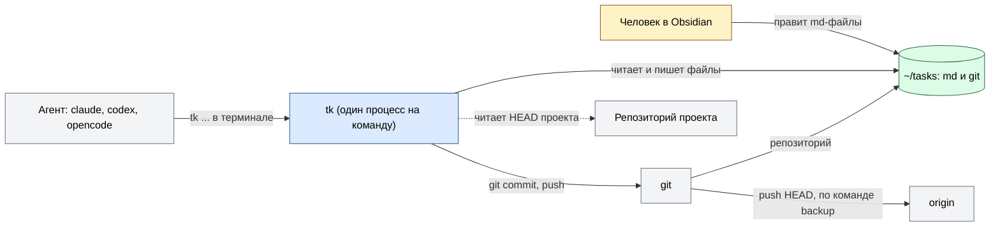
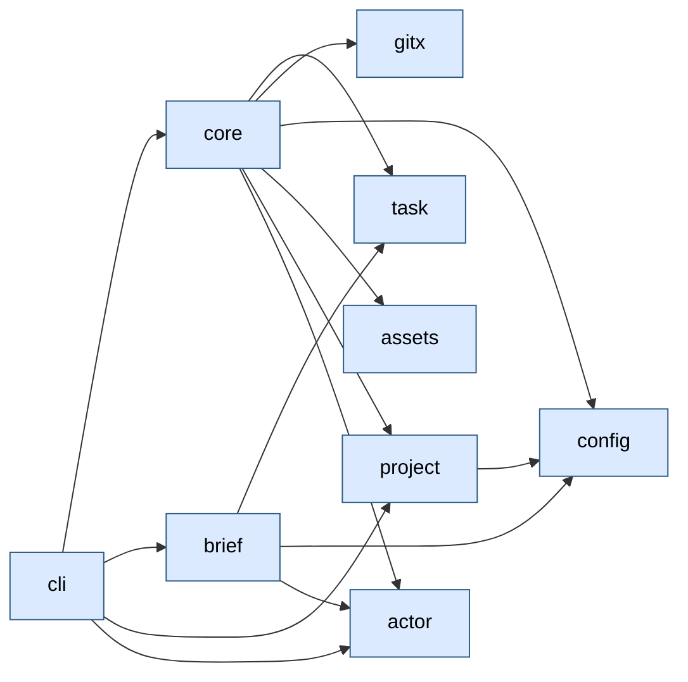
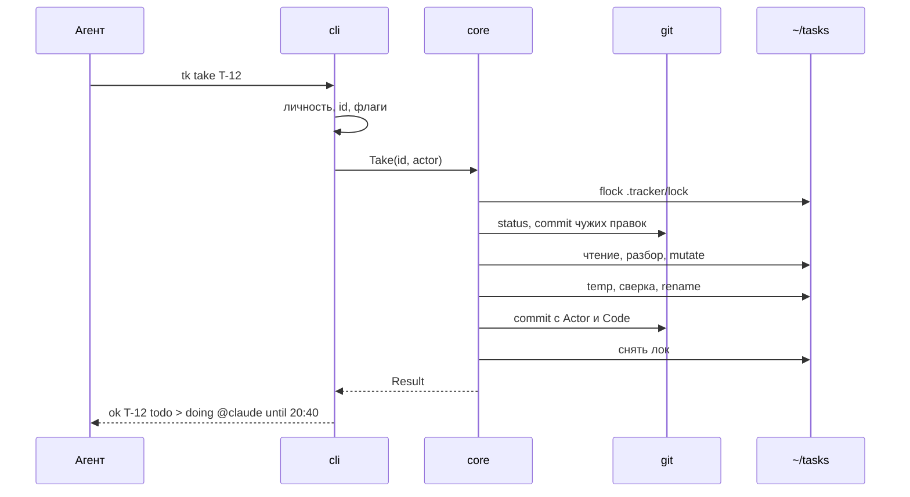
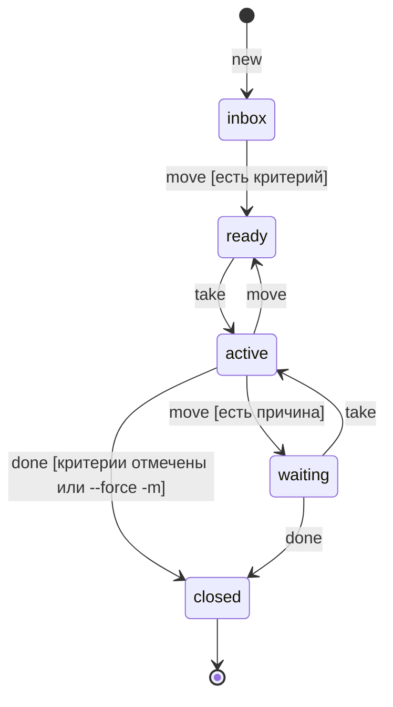

# Архитектура tracker

tracker - личный трекер задач для человека и агентов. Задача - md-файл в `~/tasks`, база - git-репозиторий, каждая правка - коммит с автором. Агенты (Claude Code, Codex, OpenCode) пишут через CLI `tk`, человек правит файлы в Obsidian. Система - один бинарь `tk` без демона: процесс запускается на команду и завершается. Состояние лежит в файлах и в git. Все внешние вызовы (git, push) делает пакет `gitx`.

Как читать: общая картина - раздел 1, как идёт работа - разделы 2 и 3, где править - раздел 9. Почему так решено - `docs/spec.md`, решения Р1-Р62 в `docs/specs/decisions.md`. Факты о git и Codex - `docs/api/git.md`, `docs/api/codex.md`. Запуск - `README.md`, правила для разработчика - `AGENTS.md`.

## Оглавление

1. Карта
2. Основной поток
3. Процессы
4. Данные и состояния
5. Внешние системы и границы доверия
6. Сбои и повторы
7. Наблюдаемость
8. Контуры и конфигурация
9. Где менять
10. Ограничения и открытое

## 1. Карта

### Назначение

Агент берёт задачу, ведёт её и закрывает командами `tk`; история правок сохраняется в git и привязана к сессии агента. Успех: два агента и человек пишут в одну базу, правки не теряются и не уходят под чужим именем.

### Контекст

Агенты и человек согласуются только через базу: лок, claim, коммиты.

### Модули

Зависимости идут вниз, циклов нет. `cmd/tk` вызывает только `cli`; `cmd/tkbench` - только `gitx`.

| Модуль | За что отвечает | Где лежит | Статус |
|---|---|---|---|
| cli | разбирает команды, печатает `ok`/`err`/`warn`, переводит ошибки в коды выхода | `internal/cli` (`cli.go` общее, `agent.go` цикл агента, `commands.go` базовые команды) | работает |
| core | единственный путь записи: лок, temp, rename, коммит, правила переходов, `backup` | `internal/core` (`tx.go` запись, `agent.go` take/move/set/check/backup, `rank.go` порядок, `history.go` трейлер `Code:` и счётчик gc) | работает |
| task | разбирает и печатает файл задачи, claim, критерии; без IO | `internal/task` | работает |
| config | читает `.tracker/config.toml`: колонки и их роли, карта проектов | `internal/config` | работает |
| brief | собирает вывод `tk ctx`: текст и JSON; без IO | `internal/brief` | работает |
| actor | личность записи: источники, проверка имени, сокращение | `internal/actor` | работает |
| project | имя проекта по рабочей папке, HEAD проекта без вызова git | `internal/project` (`project.go`, `head.go`) | работает |
| gitx | все вызовы git: коммит, merge-file, push, фоновый gc | `internal/gitx` (`gitx.go`, `push.go`) | работает |
| assets | `RULES.md`, встроенный в бинарь через `go:embed` | `internal/assets` | работает |
| TUI, коннекторы агентов | интерфейс человека; скилл и хуки в агентах | - | план (З4, З3) |

### Инварианты

| Инвариант | Где обеспечен | Чем проверяется |
|---|---|---|
| Запись в `~/tasks` только через ядро: лок, temp, rename, коммит; полузаписанных файлов нет | `core.withLock`, `core.replace` | `e2e` `Kill9AtCommit_NoPartialFiles`, `Kill9Random_RepoStaysConsistent` |
| Правка мимо ядра не теряется: следующая операция коммитит её как `external edit` | `core.syncExternal` | `e2e` `Obsidian_ExternalEdit` |
| Файл, который не разбирается, ядро не перезаписывает | `core.modifyOnce`: ошибка разбора до записи | тесты `core`, `task` (broken) |
| Коммит несёт байты операции, а не файлы дерева: чужая правка после rename не уходит под актора | `core.commit` с `gitx.CommitFiles` | `e2e` `NoteCommentDoNotCarryOtherFiles` |
| Claim ставит только `take`; `note` его не продлевает | `core.Take`, `core.extendClaim` | тесты `core` (`agent_test.go`) |
| Живой claim другого актора без `--steal` не перехватывается | `core.take` | `e2e` `FiveTakesRace_OneWinner` |
| Только `gitx` запускает внешние процессы в `internal` | `gitx`; `gosec` в линтере | `make lint` |
| `ctx` не вызывает git | `cli.cmdCtx`, `core.List`, `brief` | цель 15 мс в `make bench` |
| `backup` не держит лок на время сети; push без `--force` и без запроса пароля | `core.Backup`, `gitx.Push` | `e2e` `Backup_BareExternalEditBrokenRemote` |
| `user:pass@` из URL не попадает в ответ и лог | `gitx.scrub` | `gitx/push_test.go` |

## 2. Основной поток

Запись агента: цикл `take`, `note`, `done` на одной задаче. Каждая запись идёт одним путём через ядро.

| Шаг | Модуль | Что делает |
|---|---|---|
| 1 | cli | определяет личность (`actor.Resolve`), разворачивает `12` в `T-12` |
| 2 | core | берёт `flock` на `.tracker/lock`, ждёт до `TRACKER_LOCK_TIMEOUT` |
| 3 | core | готовит базу: `git init`, снятие висящего `index.lock`, `.gitignore`, `config.toml`, `RULES.md` (создаёт, если нет) |
| 4 | core | коммитит правки мимо ядра одним коммитом `external edit` |
| 5 | core | читает файл, `task.Parse`, применяет правило операции (`mutate`) |
| 6 | core | файл не изменился - `ok` без коммита; иначе продлевает claim владельца на 3 ч |
| 7 | core | пишет temp, сверяет файл с прочитанным, rename; файл изменился - до 3 попыток |
| 8 | gitx | коммитит байты операции с трейлерами `Actor:` и `Code: <проект>@<sha>` |
| 9 | core | снимает лок; раз в 300 коммитов запускает фоновый `git gc` |

Сбои на шагах - раздел 6.

Другие сценарии:

- `tk ctx`: `cli` читает все файлы (`core.List`, 4 воркера), `project.Detect` находит проект по папке, `brief.Build` собирает колонки `active`, `waiting`, `ready`; текст сжимается до 2000 рун. Git и лок не участвуют.
- `move`, `done`, `set`, `check` идут тем же путём; отличается правило на шаге 5 (раздел 4).

## 3. Процессы

Постоянных процессов нет.

| Процесс | Запуск | Событие | Что делает |
|---|---|---|---|
| `tk` | агент или человек, терминал | команда | читает или пишет базу и завершается |
| gc | `gitx.SpawnGC`, `sh -c` в новой сессии, переживает выход `tk` | счётчик коммитов достиг 300, после снятия лока | `git gc --quiet`, `commit-graph write --reachable --changed-paths --split`; сбой шага - строка в `.tracker/log` |

Счётчик хранится в `.tracker/lock`.

## 4. Данные и состояния

| Сущность | Источник истины | Кто меняет | Ключ или ограничение |
|---|---|---|---|
| Задача | файл `T-<N> <название>.md` в корне базы | `core` под локом | id `T-<N>`; номер из `.tracker/next_id`, не переиспользуется |
| Колонки и роли | `.tracker/config.toml` | человек; ядро создаёт при первой записи | роли: `inbox`, `ready`, `active`, `waiting`, `closed` |
| Claim | поле `claim` во frontmatter задачи | `take` (ставит), `modifyOnce` (продлевает), `move` из `active` и закрытие (снимают) | `<актор> until 2006-01-02T15:04`; истёкший свободен |
| Порядок в колонке | поле `rank` | `core.place` | число с плавающей точкой; зазор меньше 1e-6 - перенумерация колонки одним коммитом |
| История | git-репозиторий `~/tasks` | `core` через `gitx` | коммит на правку; трейлеры `Actor:`, `Code:` |
| Правила для агента | `RULES.md` в базе | ядро создаёт, если файла нет | текст встроен в бинарь; существующий не перезаписывается |
| Счётчик gc, лог | `.tracker/lock`, `.tracker/log` | `core`, `cli` | не в git |

Жизненный цикл задачи по ролям колонок. Имена колонок по умолчанию: `idea`, `todo`, `doing`, `blocked`, `done`.

Схема показывает основные пути: `move` разрешён между любыми колонками с ролью. Правила `core.enter`: в `ready` нужен критерий; в `waiting` - причина (`-m` или поле `waiting`); в `closed` - все критерии отмечены, иначе `--force` с `-m`, у задачи без критериев нужен `-m`. Выход из `waiting` чистит поле, выход из `active` и закрытие снимают claim. Переходы инициирует агент или человек; конечная колонка - `closed`.

## 5. Внешние системы и границы доверия

| Система или вход | Что отдаём и берём | Где проверяется вход до использования | Карточка |
|---|---|---|---|
| git | коммиты, `status`, `merge-file`, `push`; stderr git | `gitx`: имя remote, ключ трейлера, sha; вывод git идёт только в лог, в ответ - короткая фраза | `docs/api/git.md` |
| origin (remote) | `push HEAD`, 30 с, без `--force` | `gitx.Push`: имя без ведущего `-`; `user:pass@` вырезается | `docs/api/git.md` |
| Агент (аргументы, окружение) | команды, `--as`, id, текст | `cli`: id по шаблону `T-N`, `actor.Valid` | `docs/api/codex.md` |
| Файлы базы (Obsidian) | произвольный md | `task.Parse`; битый файл не перезаписывается, `ctx` даёт `warn` и код 0 | - |
| Репозиторий проекта | чтение HEAD файлами | `project.Head`: reftable или нет HEAD - трейлер `Code:` не пишется | `docs/api/git.md`, раздел 7 |

## 6. Сбои и повторы

| Действие или сбой | Через что идёт | Ключ идемпотентности | Повтор и потолок | Итог при провале |
|---|---|---|---|---|
| Лок занят | `flock` без блокировки, цикл ожидания | - | до `TRACKER_LOCK_TIMEOUT` (5 с) | код 2, `err`, файлы не тронуты |
| Свежий `index.lock` git | `gitx.DropGitLocks` | - | висящий старше 10 с снимается | свежий: `git is busy`, код 2 |
| Файл изменился между чтением и rename | `modifyTx` | сверка байтов | 3 попытки, каждая с `external edit` | `file changes during write, retry the command` |
| Операция без изменения файла | `modifyOnce` | совпадение вывода с файлом | - | `ok` без коммита |
| Коммит упал | `core.commit` | - | нет | правка в файле, `Warning`, `warn` в stderr, код 0; следующая операция закоммитит её как external edit |
| Убит процесс (`kill -9`) | flock снимает ОС; `cleanTmp` чистит temp | - | - | полузаписанных файлов нет |
| Правка `edit` по старой базе | `mergeBody`, `git merge-file` | blob id базы | - | конфликт: `ErrConflict`, код 3 |
| `backup`: нет `origin` | `core.Backup` | - | - | `no remote origin; run: git remote add origin <url>`, код 1 |
| `backup`: push упал или завис | `gitx.Push`, `WaitDelay` | - | 30 с, один раз | `err`, код 1, подробности в `.tracker/log` |
| Фоновый gc упал | `gcScript` | - | на следующем пороге | `WARN` в `.tracker/log` |

Коды выхода: 0 успех; 2 занято (`ErrClaimed`, `ErrLocked`); 3 конфликт; 4 нет задачи; 5 правило (`ErrRule`); 6 ввод (`ErrNoIdentity`, флаг, id); 1 прочее.

## 7. Наблюдаемость

- Сквозной ID: id задачи (`T-12`) в каждой записи лога и в теме каждого коммита; актор и проект - трейлеры `Actor:` и `Code:`.
- Логи: `slog` в `.tracker/log`, файл открывается при первой записи и только если папка уже есть. `Error` - сбой команды, `Warn` - система справилась сама (коммит не записан, висящий лок снят, gc не стартовал). Секретов и вывода git в ответе нет.
- Метрики: нет; скорость меряет `make bench`.
- Где смотреть: `git -C ~/tasks log`, `.tracker/log`; ключ `-v` печатает хеш коммита.

## 8. Контуры и конфигурация

Контур один: машина пользователя. Переменные `TRACKER_HOME`, `TRACKER_LOCK_TIMEOUT`, `TRACKER_GIT` - в `README.md`. Ещё две настройки:

| Переменная или режим | Что включает | Где задаётся |
|---|---|---|
| `TRACKER_ACTOR` | личность, если нет флага и окружения агента | окружение |
| колонки, роли, карта проектов | поведение колонок | `.tracker/config.toml` в базе |

## 9. Где менять

| Хочу изменить | Модуль | Что ещё проверить |
|---|---|---|
| Правило перехода (`ready`, `waiting`, закрытие) | `core.enter`, `core.closeChecks` в `internal/core/agent.go` | `RULES.md`, тесты `core/agent_test.go`, `e2e/cycle_test.go` |
| Срок claim, правило продления | `core.claimTTL`, `core.extendClaim` | `RULES.md`, строка вывода `take` |
| Порядок записи, лок | `internal/core/tx.go` | инварианты раздела 1, `e2e` |
| Новая команда | `cli.dispatch`, `internal/cli/agent.go` или `commands.go`, метод `Store` | usage в `cli.go`, коды выхода, `RULES.md`, `README.md` |
| Состав `ctx`, лимит текста | `internal/brief`, `cli.ctxPerColumn`, `cli.ctxTextLimit` | цель 15 мс в `cmd/tkbench`, `RULES.md` |
| Источники личности | `actor.Resolve` | `RULES.md` (раздел Identity), коннекторы З3 |
| Вызов git | `internal/gitx` | `docs/api/git.md` |
| Порог gc, трейлер `Code:` | `internal/core/history.go`, `gitx.SpawnGC` | `docs/api/git.md`, разделы 5 и 9 |
| Колонки и роли | `.tracker/config.toml`, `internal/config` | код ищет колонки по роли, имена не зашиты |
| Текст `RULES.md` | `internal/assets/RULES.md` | существующие базы не обновляются |

## 10. Ограничения и открытое

- `RULES.md` не обновляется в существующих базах: правка встроенного текста до них не доходит.
- `kill -9` во время перенумерации колонки может оставить её частично перенумерованной (сбой принят в плане З2).
- Фонового бэкапа нет. Push в настоящий remote автотестами не проверяется; remote для `~/tasks` не заведён.
- TUI (З4), скилл и хуки агентов (З3), публикация (З5) не сделаны: `docs/backlog.md`.
