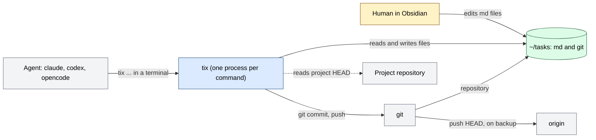
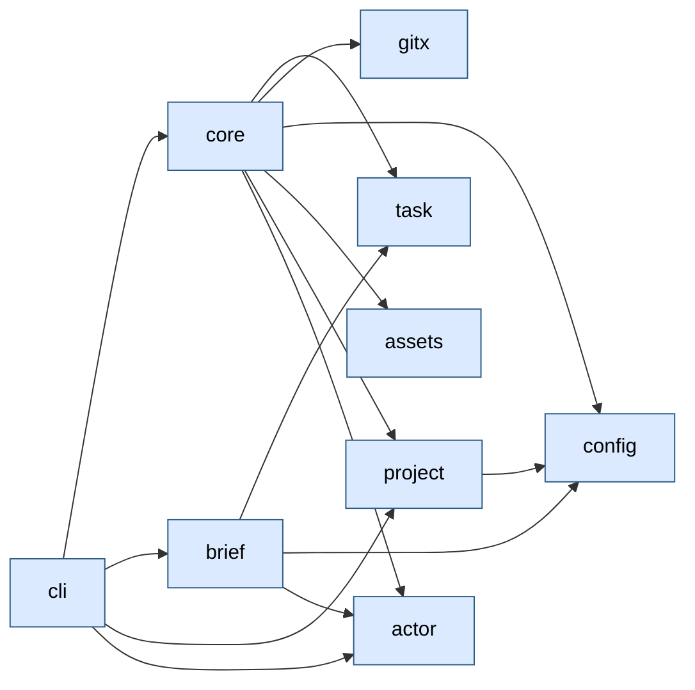
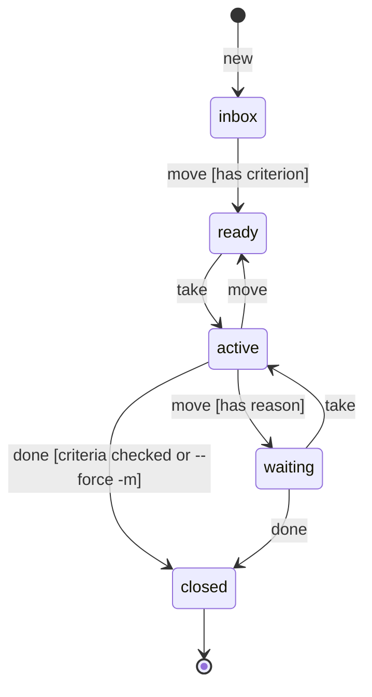

# tix architecture

tix is a personal task tracker for humans and agents. A task is an md file in `~/tasks`, the store is a git repository, and every edit is a commit with an author. Agents (Claude Code, Codex) write through the `tix` CLI, and the human edits files in Obsidian. The system is one `tix` binary with no daemon: a process starts for a command and exits. State lives in files and in git. All external calls (git, push) go through the `gitx` package.

How to read: the overall picture is section 1, the flow of work is sections 2 and 3, where to edit is section 9. Setup: `README.md`.

## Contents

1. Map
2. Main flow
3. Processes
4. Data and states
5. External systems and trust boundaries
6. Failures and retries
7. Observability
8. Environments and configuration
9. Where to change
10. Limits and open items

## 1. Map

### Purpose

An agent takes a task, works on it and closes it with `tix` commands; the edit history stays in git and is tied to the agent session. Success: two agents and a human write to one store, and edits are neither lost nor committed under a foreign name.

### Context

Agents and the human agree only through the store: lock, claim, commits.

### Modules

Dependencies point down, with no cycles. `cmd/tix` calls only `cli`; `cmd/tixbench` calls only `gitx`.

| Module | Responsibility | Where | Status |
|---|---|---|---|
| cli | parses commands, prints `ok`/`err`/`warn`, maps errors to exit codes | `internal/cli` (`cli.go` common, `agent.go` agent cycle, `commands.go` base commands) | works |
| core | the only write path: lock, temp, rename, commit, transition rules, `backup` | `internal/core` (`tx.go` write, `agent.go` take/move/set/check/backup, `rank.go` order, `history.go` `Code:` trailer and gc counter) | works |
| task | parses and prints the task file, claim, criteria; no IO | `internal/task` | works |
| config | reads `.tix/config.toml`: columns and their roles, project map | `internal/config` | works |
| brief | builds the `tix ctx` output: text and JSON; no IO | `internal/brief` | works |
| actor | write identity: sources, name check, shortening | `internal/actor` | works |
| project | project name by working folder, project HEAD without calling git | `internal/project` (`project.go`, `head.go`) | works |
| gitx | all git calls: commit, merge-file, push, background gc | `internal/gitx` (`gitx.go`, `push.go`) | works |
| assets | `RULES.md`, embedded in the binary with `go:embed` | `internal/assets` | works |
| TUI, agent connectors | human interface; skill and hooks in agents | - | planned (S4, S3) |

### Invariants

| Invariant | Enforced by | Checked by |
|---|---|---|
| Writes to `~/tasks` go only through the core: lock, temp, rename, commit; no half-written files | `core.withLock`, `core.replace` | `e2e` `Kill9AtCommit_NoPartialFiles`, `Kill9Random_RepoStaysConsistent` |
| An edit that bypasses the core is not lost: the next operation commits it as `external edit` | `core.syncExternal` | `e2e` `Obsidian_ExternalEdit` |
| The core does not overwrite a file that does not parse | `core.modifyOnce`: parse error before the write | `core`, `task` tests (broken) |
| A commit carries the bytes of the operation, not the files of the tree: a foreign edit after rename does not go under the actor | `core.commit` with `gitx.CommitFiles` | `e2e` `NoteCommentDoNotCarryOtherFiles` |
| Only `take` sets a claim; `note` does not extend it | `core.Take`, `core.extendClaim` | `core` tests (`agent_test.go`) |
| A live claim of another actor is not taken over without `--steal` | `core.take` | `e2e` `FiveTakesRace_OneWinner` |
| Only `gitx` starts external processes in `internal` | `gitx`; `gosec` in the linter | `make lint` |
| `ctx` does not call git | `cli.cmdCtx`, `core.List`, `brief` | 15 ms target in `make bench` |
| `backup` does not hold the lock during network I/O; push has no `--force` and no password prompt | `core.Backup`, `gitx.Push` | `e2e` `Backup_BareExternalEditBrokenRemote` |
| `user:pass@` from a URL does not reach the reply or the log | `gitx.scrub` | `gitx/push_test.go` |

## 2. Main flow

An agent write: the `take`, `note`, `done` cycle on one task. Every write goes one way through the core.

| Step | Module | What it does |
|---|---|---|
| 1 | cli | resolves the identity (`actor.Resolve`), expands `12` to `T-12` |
| 2 | core | takes `flock` on `.tix/lock`, waits up to `TIX_LOCK_TIMEOUT` |
| 3 | core | prepares the store: `git init`, removal of a stale `index.lock`, `.gitignore`, `config.toml`, `RULES.md` (created if missing) |
| 4 | core | commits edits that bypass the core in one `external edit` commit |
| 5 | core | reads the file, `task.Parse`, applies the operation rule (`mutate`) |
| 6 | core | file unchanged - `ok` without a commit; otherwise extends the owner's claim by 3 h |
| 7 | core | writes temp, compares the file with what was read, rename; file changed - up to 3 attempts |
| 8 | gitx | commits the bytes of the operation with trailers `Actor:` and `Code: <project>@<sha>` |
| 9 | core | releases the lock; every 300 commits starts a background `git gc` |

Failures at each step: section 6.

Other scenarios:

- `tix ctx`: `cli` reads all files (`core.List`, 4 workers), `project.Detect` finds the project by folder, `brief.Build` builds the columns `active`, `waiting`, `ready` (outside a project: `active` and `waiting`, the rest as counts); the text is trimmed to 2000 runes. Git and the lock are not involved.
- `move`, `done`, `set`, `check` follow the same path; only the rule at step 5 differs (section 4).

## 3. Processes

There are no long-lived processes.

| Process | Started by | Event | What it does |
|---|---|---|---|
| `tix` | agent or human, terminal | command | reads or writes the store and exits |
| gc | `gitx.SpawnGC`, `sh -c` in a new session, outlives the `tix` exit | commit counter reached 300, after the lock is released | `git gc --quiet`, `commit-graph write --reachable --changed-paths --split`; a failed step becomes a line in `.tix/log` |

The counter lives in `.tix/lock`.

## 4. Data and states

| Entity | Source of truth | Changed by | Key or constraint |
|---|---|---|---|
| Task | file `T-<N> <title>.md` in the store root | `core` under the lock | id `T-<N>`; number from `.tix/next_id`, never reused |
| Columns and roles | `.tix/config.toml` | human; the core creates it on the first write | roles: `inbox`, `ready`, `active`, `waiting`, `closed` |
| Claim | field `claim` in the task frontmatter | `take` (sets), `modifyOnce` (extends), `move` out of `active` and closing (release) | `<actor> until 2006-01-02T15:04`; an expired claim is free |
| Order in a column | field `rank` | `core.place` | floating-point number; a gap below 1e-6 renumbers the column in one commit |
| History | git repository `~/tasks` | `core` through `gitx` | one commit per edit; trailers `Actor:`, `Code:` |
| Agent rules | `RULES.md` in the store | the core creates it if the file is missing | text embedded in the binary; an existing file is not overwritten |
| gc counter, log | `.tix/lock`, `.tix/log` | `core`, `cli` | not in git |

The task lifecycle by column roles. Default column names: `idea`, `todo`, `doing`, `blocked`, `done`.

The diagram shows the main paths: `move` is allowed between any columns that have a role. Rules of `core.enter`: `ready` needs a criterion; `waiting` needs a reason (`-m` or the field `waiting`); `closed` needs all criteria checked, otherwise `--force` with `-m`, and a task without criteria needs `-m`. Leaving `waiting` clears the field, leaving `active` and closing release the claim. An agent or a human starts the transitions; the final column is `closed`.

## 5. External systems and trust boundaries

| System or input | What we send and take | Where input is checked before use |
|---|---|---|
| git | commits, `status`, `merge-file`, `push`; git stderr | `gitx`: remote name, trailer key, sha; git output goes only to the log, the reply gets a short phrase |
| origin (remote) | `push HEAD`, 30 s, no `--force` | `gitx.Push`: name without a leading `-`; `user:pass@` is cut out |
| Agent (arguments, environment) | commands, `--as`, id, text | `cli`: id matches `T-N`, `actor.Valid` |
| Store files (Obsidian) | arbitrary md | `task.Parse`; a broken file is not overwritten, `ctx` gives `warn` and code 0 |
| Project repository | HEAD read as files | `project.Head`: reftable or no HEAD - the `Code:` trailer is not written |

## 6. Failures and retries

| Action or failure | Goes through | Idempotency key | Retry and ceiling | Result on failure |
|---|---|---|---|---|
| Lock is busy | non-blocking `flock`, wait loop | - | up to `TIX_LOCK_TIMEOUT` (5 s) | code 2, `err`, files untouched |
| Fresh git `index.lock` | `gitx.DropGitLocks` | - | a stale one older than 10 s is removed | fresh: `git is busy`, code 2 |
| File changed between read and rename | `modifyTx` | byte comparison | 3 attempts, each with `external edit` | `file changes during write, retry the command` |
| Operation without a file change | `modifyOnce` | output equals the file | - | `ok` without a commit |
| Commit failed | `core.commit` | - | none | the edit is in the file, `Warning`, `warn` on stderr, code 0; the next operation commits it as external edit |
| Process killed (`kill -9`) | the OS releases flock; `cleanTmp` removes temp | - | - | no half-written files |
| `edit` against an old base | `mergeBody`, `git merge-file` | base blob id | - | conflict: `ErrConflict`, code 3 |
| `backup`: no `origin` | `core.Backup` | - | - | `no remote origin; run: git remote add origin <url>`, code 1 |
| `backup`: push failed or hung | `gitx.Push`, `WaitDelay` | - | 30 s, once | `err`, code 1, details in `.tix/log` |
| Background gc failed | `gcScript` | - | at the next threshold | `WARN` in `.tix/log` |

Exit codes: 0 success; 2 busy (`ErrClaimed`, `ErrLocked`); 3 conflict; 4 no task; 5 rule (`ErrRule`); 6 input (`ErrNoIdentity`, `actor.ErrAmbiguous`, flag, id); 1 other (`ErrNotRecorded` of `note`).

## 7. Observability

- End-to-end ID: the task id (`T-12`) in every log record and in the subject of every commit; actor and project are the trailers `Actor:` and `Code:`.
- Logs: `slog` in `.tix/log`; the file opens on the first write and only if the folder already exists. `Error` - a command failure, `Warn` - the system coped on its own (commit not written, stale lock removed, gc did not start). The reply has no secrets and no git output.
- Metrics: none; `make bench` measures speed.
- Where to look: `git -C ~/tasks log`, `.tix/log`; the `-v` flag prints the commit hash.

## 8. Environments and configuration

There is one environment: the user's machine. The variables `TIX_HOME`, `TIX_LOCK_TIMEOUT`, `TIX_GIT` are in `commands.md`. Two more settings:

| Variable or mode | What it enables | Where set |
|---|---|---|
| `TIX_ACTOR` | identity, if there is no flag and no agent environment | environment |
| columns, roles, project map | column behavior | `.tix/config.toml` in the store |

## 9. Where to change

| I want to change | Module | What else to check |
|---|---|---|
| A transition rule (`ready`, `waiting`, closing) | `core.enter`, `core.closeChecks` in `internal/core/agent.go` | `RULES.md`, tests `core/agent_test.go`, `e2e/cycle_test.go` |
| Claim term, extension rule | `core.claimTTL`, `core.extendClaim` | `RULES.md`, the `take` output line |
| Write order, lock | `internal/core/tx.go` | invariants of section 1, `e2e` |
| A new command | `cli.dispatch`, `internal/cli/agent.go` or `commands.go`, a `Store` method | usage in `cli.go`, exit codes, `RULES.md`, `README.md` |
| `ctx` content, text limit | `internal/brief`, `cli.ctxPerColumn`, `cli.ctxTextLimit` | 15 ms target in `cmd/tixbench`, `RULES.md` |
| Identity sources | `actor.Resolve` | `RULES.md` (section Identity), connectors S3 |
| A git call | `internal/gitx` | `internal/gitx` tests |
| gc threshold, `Code:` trailer | `internal/core/history.go`, `gitx.SpawnGC` | `internal/gitx` tests |
| Columns and roles | `.tix/config.toml`, `internal/config` | the code finds columns by role, names are not hardcoded |
| `RULES.md` text | `internal/assets/RULES.md` | move the old `assets.RulesHash` into `previousRules`: stores with an untouched copy get the new text |

## 10. Limits and open items

- `RULES.md` of a store gets the new text only while it is an untouched copy of an earlier version; an edited copy keeps the old rules.
- `kill -9` during a column renumbering can leave it partly renumbered (a known failure, accepted in S2).
- There is no background backup. Push to a real remote is not covered by autotests; no remote is set up for `~/tasks`.
