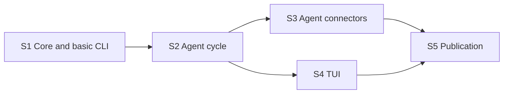

# MVP backlog

Status: approved by the user on 2026-10-20. Source - `docs/spec.md` (agreed 2026-10-20).
The path of all tasks is heavy (a new feature): task plan `docs/plans/<task>.md`, `spec-reviewer`,
thorough `code-reviewer`, risk check.

After S2 the tasks S3 and S4 run in parallel: they have different files.

## S1. Write core and basic CLI

- Spec: 2, 2.1, 2.2 (`new`, `list`, `show`, `edit`, `comment`, `note`, `rm`), 2.5 (config), 5, 7, 8, 9.
- Result: `tix new`, `list`, `show`, `edit`, `comment`, `note`, `rm` write to `~/tasks` through the lock,
  merge and a commit per edit. An Obsidian edit goes out as an external edit commit. The first write creates
  `~/tasks`. Created: `README.md`, `AGENTS.md`, `Makefile` (`check`, `bench`).
- Stage 0 (before code): measure the start and parsing of 1000 files, refine the targets of section 7; a live check of
  Codex writing to `.git` outside the working folder and of the variable `CODEX_THREAD_ID`.
- Out of scope: `ctx`, `take`, `move`, `set`, `check`, `done`, `backup`, TUI, connectors.
- Check: `make check` - the scenarios of section 3 for these commands (two agents, `edit` on an old base,
  Obsidian, lock busy, dangling `index.lock`, `kill -9`, broken file, empty `~/tasks`, commit
  failed), race 5x20 `comment`; `make bench`.
- Dependencies: none.

## S2. Agent cycle

- Spec: 2.2 (`ctx`, `take`, `move`, `set`, `check`, `done`, `backup`), 2.4 (identity), 2.5
  (move checks), 5 (`claim`), 11; D36-D41, D48 (short id), D51, D52, D54 (exit codes), D55, D58 (trailer `Code:`);
  trailers through `commit --trailer`, own garbage collection: a counter, `git gc` in the background, `commit-graph
  --changed-paths` (`docs/api/git.md`, sections 5, 9).
- Result: the agent passes the happy path of section 3 with `tix` commands alone. Claim, takeover, order
  in the column, the checks of `waiting` and of closing work. `backup` pushes to the remote. Created: `RULES.md`,
  task template, `docs/architecture.md`.
- Out of scope: TUI, installing the skill and hooks into agents, background backup.
- Check: `make check` - the scenarios happy path, foreign claim, `set status=`, closing with
  unchecked criteria, repeat, remote unavailable (a local bare repository); `make bench` for `ctx`.
- Dependencies: S1.

## S3. Agent connectors

- Spec: 2.4, 7 (`make e2e-agents`), D7, D8, D17, D49 (Claude Code plugin), D54 (hook PreCompact).
- Result: the skill `tix`, the start hook `tix ctx` and the permission for `tix` are in place in Claude Code, Codex and
  OpenCode. The home session in `~/tasks` writes an idea into `inbox`.
- Out of scope: the command `setup`, the scheduled assistant.
- Check: `make e2e-agents` - commits take, note, done with the `Actor:` of each agent. It spends subscription
  limits: a run with the user's consent.
- Risk: writes to the user's agent settings (`~/.claude`, `~/.codex`, OpenCode) - needs
  `test-designer` and a risk check.
- Dependencies: S2.

## S4. TUI

- Spec: 2.3, 7 (TUI), D9, D26, D27, D34, D38, D45, D60 (history folding), mockup `docs/mockup/ui.html`;
  modification dates `git last-modified` (fallback mtime), section history `git log -L` (`docs/api/git.md`, section 9).
- Result: `tix` without arguments opens the board and the card with history. Working: keys, move
  with an input line, order, filter by project, `$EDITOR` with a retry on conflict, yellow
  star, live refresh.
- Out of scope: theme `cards`, reply to the agent from the card, field editing (D45).
- Check: `teatest` and a stub `EDITOR`; `make bench` - open within 100 ms. The look of the TUI and
  a simultaneous edit in Obsidian - the user, by eye, once.
- Dependencies: S2.

## S5. Public repository

- Spec: D46, D47, D50 (install, completions), D53 (macOS and Linux), D54 (examples in the README), D56 (position in the README); order and content - `~/.claude/templates/github/design.md`.
- Result: a public repository as a snapshot of the working one. English README with a VHS demo, comparison
  with the analogs from `docs/research/landscape.md` and `docs/research/competitors.md`, LICENSE MIT, CHANGELOG, CI on macOS and Linux, release `v0.1.0`
  with darwin and linux binaries (amd64, arm64) and SHA256SUMS, description and topics.
- Out of scope: website, logo, README translation.
- Check: the checklist of section 9 of the design document, the result in the report.
- Needed from the user: the repository name, login `gh auth login`.
- Dependencies: S3, S4.

## After the MVP

- `tix sync` for two machines (D57, D61): `merge-tree --write-tree`, `merge=union` for comments, `bundle`.
- `tix pull` and the key `s`: status from external trackers (D61, `docs/specs/integrations.md`).

## Spec coverage

| Section | Tasks |
|---|---|
| 1 MVP table | S1-S4 |
| 2.1 core, 8 state model | S1 |
| 2.2 CLI | S1, S2 |
| 2.3 TUI | S4 |
| 2.4 connectors | S1 (stage 0), S2 (identity), S3 |
| 2.5 columns | S1 (config), S2 (checks) |
| 3 scenarios | S1, S2, S4 |
| 7 acceptance | S1 (`check`, `bench`), S3 (`e2e-agents`), S4 (`teatest`) |
| 11 text samples | S2 |
| D46 language, D47 publication | S1-S4 (strings), S5 |
