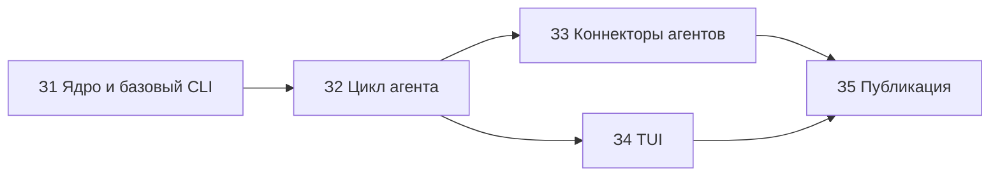

# Бэклог MVP

Статус: утверждён пользователем 20.10.2026. Источник - `docs/spec.md` (agreed 20.10.2026).
Путь всех задач - тяжёлый (новая функция): план `docs/plans/<задача>.md`, `spec-reviewer`,
`code-reviewer` тщательный, проверка рисков.

После З2 задачи З3 и З4 идут параллельно: у них разные файлы.

## З1. Ядро записи и базовый CLI

- Спека: 2, 2.1, 2.2 (`new`, `list`, `show`, `edit`, `comment`, `note`, `rm`), 2.5 (конфиг), 5, 7, 8, 9.
- Результат: `tk new`, `list`, `show`, `edit`, `comment`, `note`, `rm` пишут в `~/tasks` через лок,
  слияние и коммит на правку. Правка Obsidian уходит коммитом external edit. Первая запись создаёт
  `~/tasks`. Созданы `README.md`, `AGENTS.md`, `Makefile` (`check`, `bench`).
- Этап 0 (до кода): замер запуска и разбора 1000 файлов, цели раздела 7 уточняются; живая проверка
  записи Codex в `.git` вне рабочей папки и переменной `CODEX_THREAD_ID`.
- Не входит: `ctx`, `take`, `move`, `set`, `check`, `done`, `backup`, TUI, коннекторы.
- Проверка: `make check` - сценарии раздела 3 для этих команд (два агента, `edit` по старой базе,
  Obsidian, лок занят, висящий `index.lock`, `kill -9`, сломанный файл, пустой `~/tasks`, коммит
  упал), гонка 5x20 `comment`; `make bench`.
- Зависимости: нет.

## З2. Рабочий цикл агента

- Спека: 2.2 (`ctx`, `take`, `move`, `set`, `check`, `done`, `backup`), 2.4 (личность), 2.5
  (проверки переноса), 5 (`claim`), 11; Р36-Р41, Р48 (короткий id), Р51, Р52, Р54 (коды выхода), Р55.
- Результат: агент проходит happy path раздела 3 одними командами `tk`. Захват, перехват, порядок
  в колонке, проверки `waiting` и закрытия работают. `backup` пушит в remote. Созданы `RULES.md`,
  шаблон тикета, `docs/architecture.md`.
- Не входит: TUI, установка скилла и хуков в агенты, фоновый бэкап.
- Проверка: `make check` - сценарии happy path, чужой захват, `set status=`, закрытие с
  неотмеченными, повтор, remote недоступен (локальный bare-репозиторий); `make bench` для `ctx`.
- Зависимости: З1.

## З3. Коннекторы агентов

- Спека: 2.4, 7 (`make e2e-agents`), Р7, Р8, Р17, Р49 (плагин Claude Code), Р54 (хук PreCompact).
- Результат: скилл `tk`, хук старта `tk ctx` и разрешение `tk` стоят в Claude Code, Codex и
  OpenCode. Домашняя сессия в `~/tasks` записывает идею в `inbox`.
- Не входит: команда `setup`, ассистент по расписанию.
- Проверка: `make e2e-agents` - коммиты take, note, done с `Actor:` каждого агента. Тратит лимиты
  подписок: запуск с согласия пользователя.
- Риск: пишет в настройки агентов пользователя (`~/.claude`, `~/.codex`, OpenCode) - нужны
  `test-designer` и проверка рисков.
- Зависимости: З2.

## З4. TUI

- Спека: 2.3, 7 (TUI), Р9, Р26, Р27, Р34, Р38, Р45, макет `docs/mockup/ui.html`.
- Результат: `tk` без аргументов открывает доску и карточку с историей. Работают клавиши, перенос
  со строкой ввода, порядок, фильтр по проекту, `$EDITOR` с повтором при конфликте, жёлтая
  звёздочка, живое обновление.
- Не входит: тема `cards`, ответ агенту из карточки, правка полей (Р45).
- Проверка: `teatest` и заглушка `EDITOR`; `make bench` - открытие до 100 мс. Вид TUI и
  одновременная правка в Obsidian - пользователь глазами, один раз.
- Зависимости: З2.

## З5. Публичный репозиторий

- Спека: Р46, Р47, Р50 (установка, completions), Р53 (macOS и Linux), Р54 (примеры в README); порядок и состав - `~/.claude/templates/github/design.md`.
- Результат: публичный репозиторий снимком рабочего. README на английском с демо VHS, сравнение
  с аналогами из `docs/research/landscape.md`, LICENSE MIT, CHANGELOG, CI на macOS и Linux, релиз `v0.1.0`
  с бинарями darwin и linux (amd64, arm64) и SHA256SUMS, описание и topics.
- Не входит: сайт, логотип, перевод README.
- Проверка: чек-лист раздела 9 дизайн-документа, итог в отчёте.
- Нужно от пользователя: имя репозитория, вход `gh auth login`.
- Зависимости: З3, З4.

## Покрытие спеки

| Раздел | Задачи |
|---|---|
| 1 таблица MVP | З1-З4 |
| 2.1 ядро, 8 модель состояния | З1 |
| 2.2 CLI | З1, З2 |
| 2.3 TUI | З4 |
| 2.4 коннекторы | З1 (этап 0), З2 (личность), З3 |
| 2.5 колонки | З1 (конфиг), З2 (проверки) |
| 3 сценарии | З1, З2, З4 |
| 7 приёмка | З1 (`check`, `bench`), З3 (`e2e-agents`), З4 (`teatest`) |
| 11 образцы текстов | З2 |
| Р46 язык, Р47 публикация | З1-З4 (строки), З5 |
