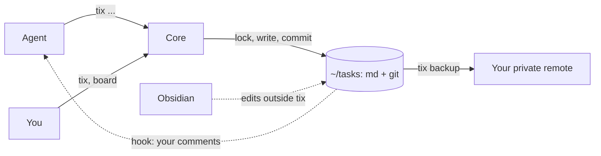

# How it works

Connecting agents, what git records, the design and a comparison. Commands and the board: [commands.md](commands.md).

## Connect your agents

`scripts/connect.sh` wires Claude Code and Codex to `tix` once. It needs bash,
`jq` and `tix` on the PATH, and runs from a clone of this repository.

```sh
scripts/connect.sh plan     # prints what apply would change, writes nothing
scripts/connect.sh apply    # adds what is missing, records it in a manifest
scripts/connect.sh undo     # removes only what the manifest lists
```

Options: `--agent claude|codex|all`, `--force` to overwrite a changed file of
ours. Backups `<file>.tix-bak-<time>` live only while `apply` runs. If it
fails, they stay and the script names them. Start a new agent session
afterwards.

| File | What is added | Agent |
|---|---|---|
| `~/.claude/settings.json` | hooks, see below; permission `Bash(tix *)` | Claude Code |
| `~/.claude/skills/tix/` | the `tix` skill | Claude Code |
| `~/.codex/hooks.json` | hooks, see below | Codex |
| `~/.codex/rules/tix.rules` | rule that allows `tix` | Codex |
| `~/.agents/skills/tix/` | the `tix` skill | Codex |
| `~/tasks/.tix/connect-state.json` | manifest used by `undo` | both |

Hooks:

| Event | Command | Why |
|---|---|---|
| `SessionStart` | `tix ctx --hook` (Claude Code), `tix ctx` (Codex) | the brief opens the session; for Claude Code the hook also records the model |
| `PostToolUse`, `UserPromptSubmit` | `tix inbox --hook` | add new comments on the agent's tasks to its context |
| `Stop` | `tix inbox --hook` | if you left a comment meanwhile, return the agent to work |

A comment is delivered once, only to the session that holds the task. A comment
by `human` also wakes an idle agent. A comment by another agent waits for the
next tool call or prompt, so two agents do not answer each other in circles.

`CLAUDE.md` and `AGENTS.md` are not touched. Codex asks you to trust new hooks:
open `/hooks` in Codex and confirm `tix inbox --hook`. The skill tells agents to
run `tix` as a single command, without `;`, `&&`, pipes or `cd`, so the Codex
rule can match it.

Example phrases that work with the skill:

- "What is next on this project?" runs `tix ctx`.
- "Write this down for later: retry the upload" runs `tix new`.
- "Take T-12 and finish it" runs `take`, `note`, `check`, `done`.

## What git records

```text
T-2: note x

Actor: claude:5f0c2e1a-9d3b-4c7e-8a41-2b6d7e9f0a13
Code: shop@c20e104ab4563c7c9e254d67dec4890f8ab3f043
Model: claude-opus-4-7
```

`Actor` is the agent session, `human` for the board, or `external` for an edit
made outside `tix`. `Code` is the project and its `HEAD` at the time. `Model`
comes from `TIX_MODEL`. The Claude Code hook sets it for the session. For other
agents, export `TIX_MODEL` yourself. The trailer is skipped when the variable is
empty or has odd characters.

## Design



One binary, no daemon: a process starts for a command and exits. All writes go
through one core path, so two agents and a human can write to the same folder
without losing edits. `edit` with `--base` merges a stale body instead of
overwriting a newer one. The map of packages is in
[docs/architecture.md](architecture.md).

<details>
<summary>Why a commit per edit?</summary>

The commit carries the session id of the agent, so `git log` shows which
conversation changed a task and when. Edits made outside `tix` are committed by
the next operation as an external edit.
</details>

<details>
<summary>Can I use it without an agent?</summary>

Yes. The files are plain markdown, and the board and `tix` work from any
terminal.
</details>

<details>
<summary>How do I back it up?</summary>

Add a private remote named `origin` in `~/tasks` and run `tix backup`.
</details>

## Comparison

State as of Oct 2026, from the READMEs and GitHub pages of the projects.

| Project | Storage | Writes | Notes |
|---|---|---|---|
| tix (this) | md files in one folder, git | lock, commit per edit with session id | local, no server |
| [Backlog.md](https://github.com/MrLesk/Backlog.md) | md in each repository | files | board in the web, MCP |
| [Beads](https://github.com/gastownhall/beads) | Dolt database | database | `ready`, `prime`, claim; no md files |
| [wedow/ticket](https://github.com/wedow/ticket) | `.tickets/` in each repository | `sed`, no lock, no commits | bash |
| [hmans/beans](https://github.com/hmans/beans) | `.beans/` in each repository | version check, no lock | board, hooks for Claude Code |
| [Baton](https://batontasks.com) | hosted service | REST, MCP | SaaS tracker for agents and people |

`tix` differs by keeping every project in one git-backed folder, linking each
edit to an agent session and a model, and needing no server.
