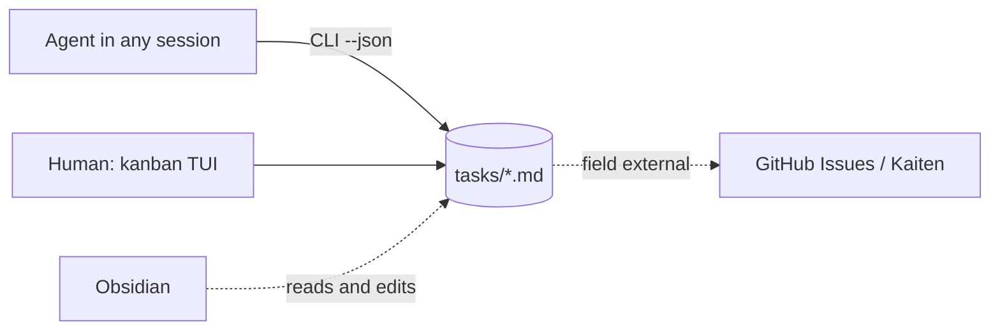

# Recon: a light task tracker in the terminal

Date: 2026-10-20. Sources: README and releases of repositories, docs.rs, crates.io, the Obsidian
documentation, GitHub and Kaiten. There are no decisions here: options, cost, recommendation.

## Contents

1. Idea and minimal scenario
2. Ready analogs
3. Storage and Obsidian
4. Agent interface
5. External trackers
6. TUI stack
7. Gaps

## 1. Idea and minimal scenario

One folder of tasks for all projects and personal ideas. A task is an md file. Agents work through the CLI,
the human through the TUI. The folder can be opened as an Obsidian vault.



Scenario: at session start the agent gets the project context with one command, takes a task,
writes comments and moves the status. The human sees the board in the TUI and reads the history of the task.

## 2. Ready analogs

There is no ready tool for the whole idea. None gives one space for all projects, the md format and
a link to external trackers together.

| Candidate | Storage | Many projects | TUI | For the agent | External | Maturity |
| --- | --- | --- | --- | --- | --- | --- |
| Backlog.md | md + frontmatter | per repo | kanban, editing on the web | `--json`, MCP | no | TS, 7k stars, v1.54 2026-10-16 |
| kanban-md | md + frontmatter | per repo | kanban view-only | JSON, `pick --claim`, `context`, `skill install` | no | Go, 225 stars, v0.39 |
| kandown | md + frontmatter | per repo, `projects` sees all | kanban, agent launch | `work`, `--json`, MCP | Trello import | JS, 13 stars, since 2026-04 |
| Beads (`bd`) | Dolt, not md | per repo | no | `ready`, `prime`, `remember`, `--claim` | GitHub, GitLab, Jira | Go, 28k stars, v1.3.1 |
| git-bug | git refs | per repo | termui | CLI, GraphQL | GitHub, GitLab, Jira | Go, 10.8k stars |
| Taskwarrior + tui + bugwarrior | own DB | yes | list, no kanban | `export` JSON | pull of many trackers | mature |
| kanban-tui (Zaloog) | SQLite | yes | Textual, full kanban | MCP, SKILL.md | Jira | Python, 286 stars |

What to take:
- the format of kanban-md: a file per task, flat YAML, foreign frontmatter fields are preserved;
- from Beads: `ready` (tasks without blockers), `prime` (context at session start), `--claim`
  (take a task atomically), `setup` for a block in CLAUDE.md;
- from kandown: `work` - rules, a digest of the board and the next task in one command;
- from Backlog.md: the schema version in `--json`, an archive that keeps ids.

Nobody has a light md editor in the TUI. This is the place where our own project brings something new.

## 3. Storage and Obsidian

Obsidian facts (obsidian.md/help/properties, /help/bases):
- Properties: text, list, number, checkbox, date, datetime, tags. Nested objects are not shown by the
  UI. The names `tags`, `aliases`, `cssclasses` are taken.
- Bases (a core plugin) groups notes by a property. The Kanban view exists since 1.14 per the documentation,
  the changelog was not checked. So Obsidian will show a board by `status` without a plugin.
- The Kanban plugin stores the board in one file: one conflict point for all agents. Not suitable.
- Obsidian merges an external edit with an open buffer (changelog 0.11.6). There is an unverified
  report of an edit loss in 1.13.1.

| Question | Options | Recon recommendation |
| --- | --- | --- |
| Files | a file per task / the board in one file | a file per task |
| Folders | flat + field `project` / a subfolder per project | flat `tasks/`, closed ones in `_archive/` |
| Comments | section `## Comments` in the file / a separate file / an operation log | a section in the file, entry with the marker `<!-- c: ISO \| author -->`, written only by the CLI |
| Write | temp + rename, `flock` on read-modify-write, creation through `O_EXCL` | all three |
| Id | counter under the lock (`T-12`) / short hash | counter; a hash if copies on several machines appear |
| Git | autocommit from the CLI / snapshot on request | git exists, the CLI does not commit |

Example of the file `tasks/T-123 fix-login-timeout.md`:

```
---
id: T-123
title: Fix login timeout
project: acme-web
status: doing
external: gh:acme/web#45
created: 2026-10-20T12:00:00
updated: 2026-10-20T14:03:00
---
The session drops after 5 minutes.

## Comments
<!-- c: 2026-10-20T13:10:00 | agent:claude -->
Reproduced, the cause is the token TTL.
```

`flock` is advisory: Obsidian and manual edits do not take it. On iCloud and Dropbox it is unreliable.

## 4. Agent interface

Decided by the user: CLI. Requirements from the analogs:
- `--json` on every command, with a schema version;
- a session start command: rules, a digest for the project, the next task;
- `claim`: take a task atomically so that two agents do not take the same one;
- `install-skill` or a block for CLAUDE.md so that the agent knows the commands without a prompt.

Start time matters: the agent makes many short calls. Measured on this Mac: a Go binary 2.4 ms,
Go with Charm 8.5 ms, Python with Textual 90 ms.

## 5. External trackers

| Level | What | Cost | Traps |
| --- | --- | --- | --- |
| 0 | field `external: gh:owner/repo#123` or `kaiten:<card>` | no code | status is visible only outside |
| 1 | pull on request: one task or "mine" | a command per tracker | a repeated pull overwrites local edits; deletion outside is not seen |
| 2 | push of status and comment | one more command, write outward | a duplicate comment on repeat; mapping status to column |
| 3 | two-way sync | weeks | all ready tools broke on it: duplicates (bugwarrior #220), closing of all tasks on a network failure (#897), rate limit (git-bug #749) |

Available now:
- GitHub: `gh` 2.102 logged in, scopes `repo` and `project`. `gh issue view/list --json` covers
  reading. Writing status in Projects v2 is awkward (three ids), open/closed and a label are simpler.
- Kaiten: REST, Bearer, 50 requests per second. An official MCP had not been released as of 2026-10-20. You already have
  the `kaiten` CLI v0.6.1 installed with `--json` and a confirmation for writes.

Recon recommendation: levels 0 and 1, then 2 only for status and comment, do not build level 3.
Two ways:
- integration as an agent skill: the tracker stores only `external`, the agent calls `gh` and `kaiten`;
  no code in the tracker, authorization already exists;
- a command `ext pull` in the tracker: deterministic, works from the TUI by a button; about a hundred lines
  per tracker.

Rules for any way: pull changes only external fields; 404 gives a mark, not a deletion;
a network error does not change status; the mapping of statuses is in the config.

## 6. TUI stack

Decided by the user: Rust, fallback Go.

| Item | Rust (Ratatui 0.30.2) | Go (Bubble Tea v2.1) |
| --- | --- | --- |
| Kanban | own, from Layout and List | own, Lip Gloss is more convenient for columns |
| Textarea | tui-textarea abandoned since 2024-10; living fork tui-textarea-2 0.13.2, one author | bubbles/textarea out of the box |
| Md rendering | tui-markdown 0.3 (API unstable) or termimad | Glamour v2, mature |
| External `$EDITOR` | by hand: leave the alternate screen and come back; vim terminal replies may leak into events | `tea.ExecProcess`, one call |
| Frontmatter | serde_yaml is deprecated; serde_yaml_ng or serde-saphyr | yaml.v3 |
| CLI | clap 4.6 | cobra or flag |
| Start | 2-4 ms expected, not measured | 2.4-8.5 ms, measured |

The cost of Rust (the scout's judgment, not a fact): the first working kanban takes 2-3 weeks against 3-5 days in Go.
More manual code: widget state, work with the external editor, md rendering.

The order that lowers risk: the core first (CLI and storage), then the TUI. The editor first through
`$EDITOR`. Check md rendering and textarea with a prototype before choosing.

## 7. Gaps

- Rust was not built: start, binary size and build time are not measured.
- tui-markdown and tui-textarea-2 were not tried in practice.
- The Kanban view in Bases: version 1.14 from the documentation, the changelog was not checked.
- The behavior of Obsidian on a simultaneous edit and `flock` on cloud drives were not checked.
- The Kaiten comments endpoint and the rights of a read-only token were not checked.
- No analog was run; the estimates come from the README.
