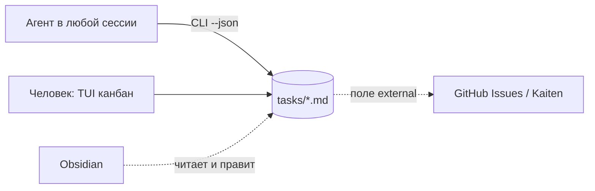

# Разведка: лёгкий трекер задач в терминале

Дата: 20.10.2026. Источники: README и релизы репозиториев, docs.rs, crates.io, документация
Obsidian, GitHub и Kaiten. Решений здесь нет: варианты, цена, рекомендация.

## Оглавление

1. Идея и минимальный сценарий
2. Готовые аналоги
3. Хранилище и Obsidian
4. Интерфейс для агента
5. Внешние трекеры
6. Стек TUI
7. Пробелы

## 1. Идея и минимальный сценарий

Одна папка задач для всех проектов и личных идей. Задача - md-файл. Агенты работают через CLI,
человек через TUI. Папку можно открыть как vault Obsidian.



Сценарий: агент на старте сессии получает контекст проекта одной командой, берёт задачу,
пишет комментарии и двигает статус. Человек видит доску в TUI и читает историю задачи.

## 2. Готовые аналоги

Готового под идею целиком нет. Ни один не даёт одно пространство на все проекты, md-формат и
связь с внешними трекерами вместе.

| Кандидат | Хранилище | Много проектов | TUI | Агенту | Внешние | Зрелость |
| --- | --- | --- | --- | --- | --- | --- |
| Backlog.md | md + frontmatter | на репо | канбан, правка в вебе | `--json`, MCP | нет | TS, 7 тыс. зв., v1.54 16.10.2026 |
| kanban-md | md + frontmatter | на репо | канбан только смотреть | JSON, `pick --claim`, `context`, `skill install` | нет | Go, 225 зв., v0.39 |
| kandown | md + frontmatter | на репо, `projects` видит все | канбан, запуск агента | `work`, `--json`, MCP | импорт Trello | JS, 13 зв., с 04.2026 |
| Beads (`bd`) | Dolt, не md | на репо | нет | `ready`, `prime`, `remember`, `--claim` | GitHub, GitLab, Jira | Go, 28 тыс. зв., v1.3.1 |
| git-bug | git refs | на репо | termui | CLI, GraphQL | GitHub, GitLab, Jira | Go, 10,8 тыс. зв. |
| Taskwarrior + tui + bugwarrior | своя БД | да | список, без канбана | `export` JSON | pull многих трекеров | зрелый |
| kanban-tui (Zaloog) | SQLite | да | Textual, полный канбан | MCP, SKILL.md | Jira | Python, 286 зв. |

Что взять:
- формат kanban-md: файл на задачу, плоский YAML, чужие поля frontmatter сохраняются;
- из Beads: `ready` (задачи без блокеров), `prime` (контекст на старте сессии), `--claim`
  (атомарно взять задачу), `setup` для блока в CLAUDE.md;
- из kandown: `work` - правила, дайджест доски и следующая задача одной командой;
- из Backlog.md: версия схемы в `--json`, архив с сохранением id.

Лёгкого md-редактора в TUI нет ни у кого. Это место, где свой проект даёт новое.

## 3. Хранилище и Obsidian

Факты Obsidian (obsidian.md/help/properties, /help/bases):
- Properties: text, list, number, checkbox, date, datetime, tags. Вложенные объекты UI не
  показывает. Имена `tags`, `aliases`, `cssclasses` заняты.
- Bases (core-плагин) группирует заметки по свойству. Вид Kanban по документации есть с 1.14,
  changelog не сверен. Значит, доску по `status` Obsidian покажет без плагина.
- Плагин Kanban хранит доску одним файлом: одна точка конфликта для всех агентов. Не подходит.
- Obsidian сливает внешнюю правку с открытым буфером (changelog 0.11.6). Есть непроверенный
  отчёт о потере правки в 1.13.1.

| Вопрос | Варианты | Рекомендация разведки |
| --- | --- | --- |
| Файлы | файл на задачу / доска одним файлом | файл на задачу |
| Папки | плоско + поле `project` / подпапка на проект | плоско `tasks/`, закрытые в `_archive/` |
| Комментарии | раздел `## Comments` в файле / отдельный файл / лог операций | раздел в файле, запись с маркером `<!-- c: ISO \| автор -->`, пишет только CLI |
| Запись | temp + rename, `flock` на чтение-изменение-запись, создание через `O_EXCL` | всё три |
| Id | счётчик под локом (`T-12`) / короткий хеш | счётчик; хеш, если появятся копии на нескольких машинах |
| Git | автокоммит из CLI / снимок по запросу | git есть, CLI не коммитит |

Пример файла `tasks/T-123 fix-login-timeout.md`:

```
---
id: T-123
title: Fix login timeout
project: acme-web
status: doing
external: gh:acme/web#45
created: 2026-10-20T12:00:00
updated: 2026-10-20T14:03:00
---
Сессия рвётся через 5 минут.

## Comments
<!-- c: 2026-10-20T13:10:00 | agent:claude -->
Воспроизвёл, причина в TTL токена.
```

`flock` advisory: Obsidian и ручная правка его не берут. На iCloud и Dropbox он ненадёжен.

## 4. Интерфейс для агента

Решено пользователем: CLI. Требования из аналогов:
- `--json` на каждой команде, со версией схемы;
- команда старта сессии: правила, дайджест по проекту, следующая задача;
- `claim`: взять задачу атомарно, чтобы два агента не взяли одну;
- `install-skill` или блок для CLAUDE.md, чтобы агент знал команды без промпта.

Время запуска важно: агент делает много коротких вызовов. Замер на этом маке: бинарь Go 2,4 мс,
Go с Charm 8,5 мс, Python с Textual 90 мс.

## 5. Внешние трекеры

| Уровень | Что | Цена | Ловушки |
| --- | --- | --- | --- |
| 0 | поле `external: gh:owner/repo#123` или `kaiten:<card>` | кода нет | статус виден только снаружи |
| 1 | pull по запросу: одна задача или «мои» | команда на трекер | повторный pull затирает локальные правки; удаление снаружи не видно |
| 2 | push статуса и комментария | ещё команда, запись наружу | дубль комментария при повторе; маппинг статуса в колонку |
| 3 | двусторонняя синхронизация | недели | на нём ломались все готовые: дубли (bugwarrior #220), закрытие всех задач при сбое сети (#897), rate limit (git-bug #749) |

Доступно сейчас:
- GitHub: `gh` 2.102 залогинен, scopes `repo` и `project`. `gh issue view/list --json` покрывает
  чтение. Статус в Projects v2 писать неудобно (три id), проще open/closed и label.
- Kaiten: REST, Bearer, 50 запросов в секунду. Официальный MCP на 20.10.2026 не вышел. У вас уже
  стоит `kaiten` CLI v0.6.1 с `--json` и подтверждением записи.

Рекомендация разведки: уровни 0 и 1, затем 2 только для статуса и комментария, уровень 3 не
строить. Два способа:
- интеграция как скилл агента: трекер хранит только `external`, агент зовёт `gh` и `kaiten`;
  кода в трекере нет, авторизация уже есть;
- команда `ext pull` в трекере: детерминировано, работает из TUI кнопкой; около сотни строк
  на трекер.

Правила для любого способа: pull меняет только внешние поля; 404 даёт пометку, не удаление;
ошибка сети не меняет статус; маппинг статусов в конфиге.

## 6. Стек TUI

Решено пользователем: Rust, запасной Go.

| Пункт | Rust (Ratatui 0.30.2) | Go (Bubble Tea v2.1) |
| --- | --- | --- |
| Канбан | свой из Layout и List | свой, Lip Gloss удобнее для колонок |
| Textarea | tui-textarea заброшен с 10.2024; живой форк tui-textarea-2 0.13.2, один автор | bubbles/textarea из коробки |
| Рендер md | tui-markdown 0.3 (API нестабилен) или termimad | Glamour v2, зрелый |
| Внешний `$EDITOR` | вручную: выйти из alternate screen и вернуться; ответы терминала vim могут утечь в события | `tea.ExecProcess`, один вызов |
| Frontmatter | serde_yaml устарел; serde_yaml_ng или serde-saphyr | yaml.v3 |
| CLI | clap 4.6 | cobra или flag |
| Запуск | ожидается 2-4 мс, не замерено | 2,4-8,5 мс, замерено |

Цена Rust (суждение разведчика, не факт): первый рабочий канбан 2-3 недели против 3-5 дней на Go.
Больше ручного кода: состояние виджетов, работа с внешним редактором, рендер md.

Порядок, который снижает риск: сначала ядро (CLI и хранилище), потом TUI. Редактор сначала через
`$EDITOR`. Рендер md и textarea проверить прототипом до выбора.

## 7. Пробелы

- Rust не собирали: запуск, размер бинаря и время сборки не замерены.
- tui-markdown и tui-textarea-2 в деле не проверены.
- Вид Kanban в Bases: версия 1.14 из документации, changelog не сверен.
- Поведение Obsidian при одновременной правке и `flock` на облачных дисках не проверены.
- Эндпоинт комментариев Kaiten и права read-only токена не проверены.
- Ни один аналог не запускали; оценки по README.
