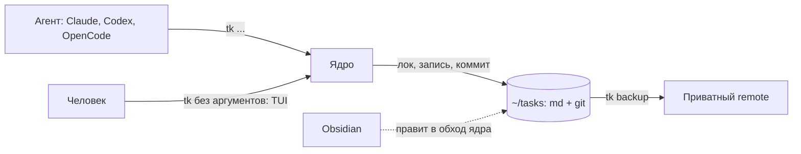
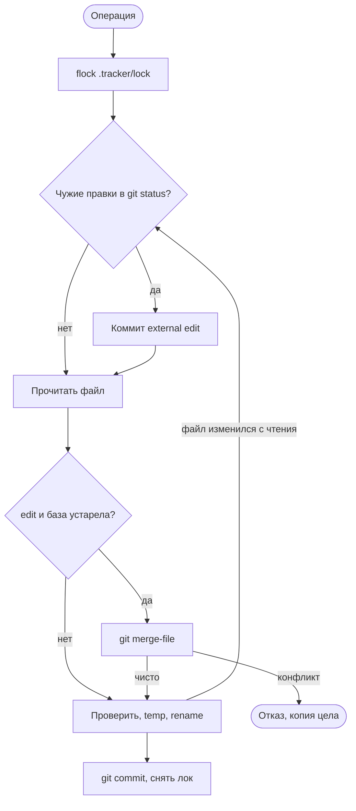

# Спека: tracker, ассистент с трекером задач

Статус: agreed 20.10.2026, ревью 1-3 пройдены (`docs/research/spec-review-*.md`)
Каноны: `docs/research/landscape.md`, макет `docs/mockup/ui.html`, после MVP `docs/specs/integrations.md`

Черновик собран агентом 20.10.2026 из решений пользователя (раздел 12). Пометка «предложение» -
техническое решение агента, пользователь может отменить. Весь код пишет агент.

## Оглавление

1. Цель и границы
2. Архитектура
3. Сценарии
4. Данные и состояния
5. Кодовая модель
6. Этапы реализации
7. Критерий приёмки
8. Модель состояния
9. Внешние факты
10. Трассировка требований
11. Образцы текстов
12. Решения и вопросы
13. Нарезка
14. Доступы и готовность

## 1. Цель и границы

- Цель: личный ассистент с трекером задач. Одна папка задач на все проекты и личные идеи. Агент
  ведёт задачи, человек смотрит доску и карточки. Трекер - память между сессиями: любая сессия
  любого агента читает задачу и понимает её состояние.
- Принцип (Р44): эталон скорости, лёгкости и надёжности. Каждая часть проходит вопрос «что
  сломается, если её убрать»; ответ «ничего» - часть убирается. Числа - раздел 7.

| Функция | MVP | После MVP | Не делаем |
|---|---|---|---|
| Ядро: md-файлы, лок, коммит на правку, слияние, подхват правок Obsidian | да | | |
| CLI `tk`: 14 команд (2.2) | да | | |
| TUI, тема `ascii`: доска, карточка с историей, `$EDITOR`, перенос, порядок, фильтр по проекту, живое обновление | да | | |
| Колонки с ролями в `config.toml`; поля `waiting`, `claim`, `due`, `tags`, `ask` | да | свои поля, выбор темы, тема `cards` | |
| Жёлтая звёздочка при `ask` | да | ответ агенту из карточки; цвета по виду нужды | |
| Подключение Claude Code, Codex, OpenCode: скилл, хук, разрешение | агент ставит один раз | команда `setup` | |
| `RULES.md`, домашняя сессия в `~/tasks` | да | | |
| Бэкап `git push` в приватный remote | командой | в фоне | |
| Внешние трекеры | `external` как ссылка | статус и итог (`docs/specs/integrations.md`) | синхронизация полей и комментариев |
| Ассистент по расписанию, время исполнения на экране | | да | |
| Публичный репозиторий: README, демо, CI, релиз (Р47) | | да, З5 | |
| Операционный центр: запуск агента из карточки, просмотр сессии | | своя спека; опора - Galera #165 | в ближних версиях |
| `blocked_by`, `parent`, архив закрытых, встроенный редактор, боковая панель, вид в Obsidian Bases | | при необходимости | |
| `estimate`, `branch`, `links`; правка комментариев; сервер, веб, несколько машин; своя LLM | | | да |

## 2. Архитектура

Одобрена пользователем 20.10.2026. Стек: Go, Bubble Tea. Один бинарь `tk`.

| Блок | Ответственность |
|---|---|
| ядро | чтение, проверка, лок, запись, коммит, слияние, лог |
| CLI | команды агента, ответ одной строкой |
| TUI | доска, карточка, `$EDITOR`, живое обновление (`fsnotify`) |
| `RULES.md`, домашняя сессия | роль ассистента и правила карточек |

Корень - `~/tasks`; `TRACKER_HOME` перекрывает (тесты). Ошибка - одна строка, код выхода не 0,
подробности в `.tracker/log`.

### 2.1 Ядро: алгоритм записи

1. Назначение: единственный путь записи для CLI и TUI; защищает от потери правок.
2. Вход и выход: операция над задачей; файл задачи и один коммит.
3. Как работает (предложение):

   1. Лок: `syscall.Flock` на `.tracker/lock`, снимается при смерти процесса; ожидание 5 с
      (`TRACKER_LOCK_TIMEOUT` в тестах).
   2. `git status`: правки в обход ядра (Obsidian, ручные, упавший прошлый коммит) коммитятся
      сообщением со строкой `T-12: external edit` на каждый id, `Actor: external`; файл без id
      (`RULES.md`, `config.toml`, `Untitled.md`) - строкой `external edit: <путь>`.
   3. Точечная операция (поле, перенос, порядок, чекбокс, комментарий, удаление) применяется к
      текущей версии без базы. `edit` заменяет только тело до `## Comments` и несёт базу
      `rev`; устарела - `git merge-file`.
   4. Запись во временный файл, сверка, что файл не изменился с чтения, rename. Изменился -
      повтор с шага 2, до трёх раз; окно между сверкой и rename - принятый риск.
   5. Коммит только путей операции (`git commit -- <пути>`). Упал - правка уже в файле, ответ
      `ok` с предупреждением, код 0, запись в лог; следующая операция закоммитит её как external edit.
4. Критичные правила:
   - одна правка - один коммит; сообщение начинается с `T-12:`; трейлер `Actor:`;
   - git: `-c commit.gpgsign=false -c core.hooksPath=/dev/null -c user.name=tracker
     -c user.email=tracker@localhost`; читатели с `--no-optional-locks`; висящий `index.lock`
     под нашим локом удаляется с записью в лог; вызов git подменяется в тестах;
   - `rev` - git blob id; чтение для `edit` и `$EDITOR` пишет blob в git (`hash-object -w`),
     поэтому база слияния есть всегда, даже после правки Obsidian;
   - `note` - пустой коммит; история карточки - `git log --grep '^T-12:'`;
   - файл, который не разбирается, ядро не перезаписывает, а сообщает путь и ошибку;
   - frontmatter через `yaml.v3` Node: порядок и чужие поля сохраняются; даты изменения из git;
   - всё после `## Comments` - комментарии; разбор по маркерам `<!-- c: ISO | автор -->`;
   - `id` - счётчик `.tracker/next_id` под локом, в git; имя файла после создания не меняется;
   - удаление - `git rm`; возврат - `git checkout <rev> -- <файл>`, ядро коммитит как external edit;
   - первая запись создаёт `~/tasks`, git, `config.toml`, `.gitignore` (`.tracker/{tmp,lock,log}`,
     `.obsidian/workspace*`, `.trash/`, `*.swp`). Задачи - только `T-*.md`.

### 2.2 CLI

1. Назначение: интерфейс агента с минимумом токенов.
2. Вход и выход: команда; ответ одной строкой; `--json` только у `ctx`, `list`, `show`.
3. Команды (предложение, образец - вкладка «агент» макета):

| Команда | Что делает |
|---|---|
| `ctx` | правила кратко, задачи проекта в `active`, `waiting`, `ready` (до 5 на колонку по `rank`, дальше «ещё K»), следующая задача; до 2000 знаков |
| `list`, `show` | список с фильтрами; задача целиком, с `rev` |
| `new` | новая задача, по умолчанию в `inbox` |
| `take` | в `active` и `claim`; `--steal` перехват (Р39); `--release` снять захват |
| `move` | перенос с проверками 2.5; порядок `--first` или `--after T-9`, `rank` считает ядро под локом |
| `set` | только `title`, `waiting`, `due`, `tags`, `ask`, `external`, `abstract`, `summary` |
| `edit` | тело из stdin с `--base <rev>`; комментарии не трогает; `## Comments` в новом теле - отказ |
| `check`, `note`, `comment` | отметить критерий; шаг в историю; комментарий |
| `done` | закрыть; итог `-m` - комментарием «Итог: ...»; `--force` (Р40) |
| `rm`, `backup` | удалить; коммит правок в обход ядра (шаг 2 из 2.1), затем `git push` |

   - `status`, `id`, `created`, `claim`, `rank` меняются только своими командами (`move`, `take`,
     `done`); `set` и `edit` их не принимают;
   - проект: имя папки над `.git` (у worktree - над основной), поиск в Go без запуска git; карта
     имён в конфиге; `--project` перекрывает; в `~/tasks` - все проекты, `new` - проект `personal`;
   - повтор `take` той же сессией, `done` закрытой задачи, перенос в ту же колонку - `ok` без
     коммита.
4. Критичные правила: числа раздела 7.

### 2.3 TUI

1. Назначение: экран человека, в первую очередь просмотр.
2. Вход и выход: клавиши; одна очередь операций в фоне, экран не блокируется локом.
3. Как работает (макет):
   - ASCII: текст, линии из дефисов; цвета основной, приглушённый, акцент; жёлтая звёздочка -
     нужно ваше действие; оранжевый - ошибка;
   - доска: номер, проект, название, первая строка сводки, критерии, срок, `claim`, звёздочка;
     неизвестная колонка - колонка `?`;
   - карточка: заголовок и колонка, поля строкой, строка `ask`, абстракт, сводка, подробно,
     история (коммиты по `--grep` и комментарии по времени);
   - клавиши: `h j k l`, `enter`, `m M` перенос, `J K` порядок, `p` проект, `e` редактор,
     `c` комментарий, `esc`.
4. Критичные правила:
   - `$EDITOR` правит копию тела в `.tracker/tmp/`; не изменена - отмена; изменена - `edit` с
     базой, открытой до редактора; конфликт - редактор снова с маркерами, база - версия, против
     которой показан конфликт; при любом отказе копия остаётся, путь в строке ошибки;
   - перенос в `waiting` и `done` с неотмеченными критериями спрашивают одну строку внизу экрана:
     чего ждём или причину закрытия;
   - паника перехватывается, терминал восстанавливается, ошибка в лог.

### 2.4 Коннекторы агентов

1. Назначение: агент знает трекер и получает контекст на старте.
2. Вход и выход: файлы в настройках агента; в MVP их ставит агент один раз.
3. Как работает (разведка 20.10.2026):

| Что | Claude Code | Codex | OpenCode |
|---|---|---|---|
| скилл `tk` (в контексте только описание) | `~/.claude/skills/tk` | `~/.agents/skills/tk` | читает `~/.agents/skills` |
| хук старта `tk ctx` | SessionStart | SessionStart, одобрить в `/hooks` | нет; скилл велит вызвать `ctx` |
| разрешение | `Bash(tk *)` | `prefix_rule` в `~/.codex/rules/default.rules` | `permission.bash` |

4. Критичные правила:
   - личность (`Actor:` и `claim`), по порядку: `--as`; переменная агента
     (`CLAUDE_CODE_SESSION_ID`, `CODEX_THREAD_ID`); `TRACKER_ACTOR`; TUI - `human`. Личности
     нет - `take` отказывает с подсказкой передать `--as агент:id`, прочие команды пишут
     `unknown`. OpenCode: скилл велит агенту придумать id на сессию и передавать `--as`;
   - `CLAUDE.md` и `AGENTS.md` не трогаем - у пользователя это симлинки на один файл;
   - Codex: `.git` вне рабочей папки только для чтения; `prefix_rule` выводит `tk` из песочницы
     только для одиночной команды, без `;`, `&&`, пайпов и `cd` (проверено, `docs/api/codex.md`).

### 2.5 Колонки

Роль колонки говорит программе, что колонка значит, независимо от имени (Р24). Одна роль - одна
колонка; колонку без роли агент не трогает; колонку с задачами нельзя удалить без переноса.
Ошибка `config.toml` - путь и строка.

| Роль | По умолчанию | Проверка при переносе |
|---|---|---|
| `inbox` | idea | - |
| `ready` | todo | хотя бы один критерий; отсюда `ctx` берёт следующую задачу |
| `active` | doing | здесь считается время исполнения |
| `waiting` | blocked | нужно `waiting` (Р41) |
| `closed` | done | все критерии отмечены или `--force -m` (Р40) |

## 3. Сценарии

| Сценарий | Шаги | Результат |
|---|---|---|
| Happy path | Хук отдал `ctx`; агент `take`, `note`, `check`, `set summary=`, `comment`, `done -m` | Задача в `closed`, история шагов в git |
| Идея | Пользователь в домашней сессии: «запиши идею» | Задача в `inbox`, проект `personal` |
| Два агента, разные задачи | Пишут одновременно | Лок ставит записи в очередь |
| Чужой захват | Вторая сессия делает `take` | Отказ с владельцем и сроком; `--steal` перехватывает, перехват в истории |
| `edit` по старой базе | Файл успел измениться | Слияние; конфликт - отказ, агент перечитывает |
| `$EDITOR` и комментарий агента | Разные части файла | Слияние чисто |
| `$EDITOR` и правка тех же строк | Конфликт | Редактор снова с маркерами; копия цела |
| Правка в Obsidian | Файл изменён без ядра | Следующая операция коммитит его как external edit |
| `set status=` | Попытка обойти `move` | Отказ с подсказкой команды |
| Закрытие с неотмеченными критериями | `done` | Отказ с перечнем; `--force -m` закрывает |
| Повтор | Агент повторил команду | `ok` без коммита; повторный комментарий - дубль |
| Лок занят | Пишет другой процесс | Ожидание 5 с, ошибка одной строкой |
| Висящий `index.lock` | git убит | Удаляется под нашим локом, запись в лог |
| Процесс убит посреди записи | `kill -9` | Нет полузаписанных файлов; следующая операция коммитит записанное |
| Сломанный файл или конфиг | Не разбирается | Ядро не пишет, показывает путь и строку |
| Пустой `~/tasks` | Хук `ctx` | Одна строка; первая запись создаёт папку |
| Remote недоступен | `backup` | Ошибка одной строкой |

## 4. Данные и состояния

См. раздел 8.

## 5. Кодовая модель

- Задача: frontmatter `id`, `title`, `project`, `status`, `rank` (дробный), `created`,
  `external`, `waiting`, `claim`, `due`, `tags`, `ask`. Тело (Р23, Р25): `## Abstract`,
  `## Summary` (первая строка - на доске), `## Details` (критерии чекбоксами, ссылки),
  `## Comments` (только дописывается).
- `claim`: `актор до ISO`; проверяет только `take`; продлевают на 3 ч записи владельца в файл
  (`note` - нет); снимают `take --release`, `done`, перенос из `active`, истечение (Р36, Р39).
- Событие истории: коммит `T-12: <операция> [текст]`, трейлер `Actor:`.

## 6. Этапы реализации

См. раздел 13.

## 7. Критерий приёмки

Пользователь код не читает (Р33), поэтому приёмка автоматическая.

- `make check` во временной папке (`TRACKER_HOME`):
  - тесты ядра на сценарии раздела 3; подмена вызова git для «коммит упал»;
  - гонка: 5 процессов по 20 `comment` - 100 комментариев и 100 коммитов;
  - `kill -9` посреди записи: нет полузаписанных файлов, `git fsck` чист;
  - TUI через `teatest` и заглушку `EDITOR`.
- `make bench`, цели (предложение, уточнить замером в первой задаче) на 1000 задач:

| Операция | Цель |
|---|---|
| `ctx`, `list`, `show` | до 15 мс; без Glamour и других библиотек с тяжёлым init (тема ASCII его не требует) |
| запись с коммитом | до 50 мс; первая после правки мимо ядра - до 70 мс (замер 55) |
| открытие TUI | до 100 мс |

- `make e2e-agents`: фикстура - задача в `ready` с одним критерием и один промпт; `claude -p
  --allowedTools "Bash(tk *)"`, `codex exec` с `prefix_rule`, `opencode run`. Pass - коммиты take,
  note, done с `Actor:` агента. Тратит лимиты подписок: в конце этапа с согласия пользователя.
- Не автоматизируется: вид TUI и Obsidian - пользователь глазами; одновременная правка в
  Obsidian - пользователь один раз, иначе принятый риск.

## 8. Модель состояния

| Сущность | Состояния и переходы | Заморожено | Писатель | Хранение |
|---|---|---|---|---|
| Задача | колонки конфига; переход между любыми с проверками 2.5; удаление | `id`, `created`, имя файла | ядро; Obsidian в обход | `~/tasks/T-12 <slug>.md` |
| Комментарий | создан | всё | ядро | раздел в файле |
| Заметка | создана | всё | ядро | пустой коммит |
| Захват | свободна; занята 3 ч с продлением; снят, перехвачен, истёк | - | ядро | `claim` |
| Конфиг | колонки меняются | пять ролей | ядро или человек | `.tracker/config.toml` |

Права агента: заводит, переводит из `inbox` в `ready`, закрывает, удаляет, меняет конфиг.

## 9. Внешние факты

| Система | Факт | Источник, дата | Если иначе |
|---|---|---|---|
| Obsidian | свойства плоские; `tags`, `aliases`, `cssclasses` заняты | obsidian.md/help/properties, 20.10.2026 | - |
| Obsidian | сливает внешнюю правку с открытым буфером; потеря правки не подтверждена | changelog 0.11.6 | принятый риск |
| git | `merge-file` склеивает правки в разных местах; `log -- <файл>` пропускает пустые коммиты | прогон 20.10.2026; ревью 1 | - |
| Агенты | скиллы ленивые у всех трёх; хук старта у Claude и Codex; `CLAUDE_CODE_SESSION_ID` в окружении | документация, `env`, 20.10.2026 | OpenCode берёт `ctx` по скиллу |
| Codex | `.git` только для чтения; allow снимает песочницу с одиночной `tk`; `CODEX_THREAD_ID` - UUID | `docs/api/codex.md` | каталог `.tkgit` |
| Bubble Tea | v2.1.0; Bubbles v2.2.1; запуск бинаря 2,3 мс | releases, замер 20.10.2026 | - |

## 10. Трассировка требований

ТЗ нет; требования - решения Р1-Р55, задачи - `docs/backlog.md`.

## 11. Образцы текстов

Экраны и вывод CLI - макет `docs/mockup/ui.html`. `RULES.md` и шаблон тикета - первая задача.

## 12. Решения и вопросы

Решения пользователя, 20.10.2026:

- Р1. Своё, не форк: аналоги привязаны к репозиторию, без внешних трекеров и md-редактора в TUI.
- Р2. Ассистент с трекером: агент ведёт задачи, человек смотрит.
- Р3. md-файл на задачу в `~/tasks`, свой git.
- Р4. Коммит на каждую правку: история, время исполнения, откат, бэкап.
- Р5. Колонки idea, todo, doing, blocked, done; добавляются и удаляются.
- Р6. Приоритет - порядок в колонке.
- Р7. Агент управляет через CLI; правила в `~/tasks/RULES.md`.
- Р8. Ассистент: роль в `RULES.md`, домашняя сессия в `~/tasks`, работа по расписанию.
- Р9. Правка в `$EDITOR`, встроенный редактор позже.
- Р10. Поля по умолчанию - минимум.
- Р11. Тело и комментарии свободные, шаблоны в `RULES.md`; проверки формата - только 2.5.
- Р12. История из `git log` и комментариев файла.
- Р13. Карточку читают пользователь и агенты: технические детали допустимы.
- Р14. Внешние трекеры подключаются командой трекера, не скиллом.
- Р15. Go. Отброшено: Rust - код пишет агент, у Go больше готовых частей TUI.
- Р16. Только локально, одна машина, личное пользование.
- Р17. Агенты Claude Code, Codex, OpenCode; минимум токенов и времени на трекер.
- Р18. Проект не разрастается, упор на MVP.
- Р19. Архитектура одобрена; трекеры и агенты - адаптерами и коннекторами.
- Р20. Колонки настраиваются агентом или вручную; свои поля - после MVP.
- Р21. Поля MVP: `waiting`, `claim`, `due`, `tags`, `ask`.
- Р22. Бэкап: push в приватный remote.
- Р23. Тикет: название, абстракт, сводка, подробности, комментарии.
- Р24. Пять ролей колонок, одна роль - одна колонка.
- Р25. Абстракт и сводка - разделы тела; «что дальше» - первая строка сводки.
- Р26. Отдельного экрана сводки нет.
- Р27. TUI в стиле ASCII.
- Р28. История действий: взял, перенёс, заметки «сделал X».
- Р29-Р32. Внешние трекеры после MVP по `docs/specs/integrations.md`; в MVP `external` - ссылка.
- Р33. Код пишет агент; приёмка автоматическая.
- Р34. Тема `ascii` в MVP, `cards` после.
- Р35. Границы MVP - таблица раздела 1.
- Р36. `claim` на 3 часа; агент снимает по окончании или продлевает.
- Р37. `RULES.md`: остаток - в новую задачу; новый объём - новая задача; итог сессии
  комментарием `Done / Decided / Waiting`.
- Р38. Нужно действие пользователя - жёлтая звёздочка; `ask` - что нужно.
- Р39. Захват принадлежит сессии; перехват явный, `take --steal`.
- Р40. `done` с неотмеченными критериями - отказ; `--force -m` закрывает.
- Р41. Перенос в `blocked` требует `waiting`.
- Р42. В MVP набор полей фиксирован, тема зашита в код.
- Р43. Имя `tracker`, команда `tk` (рабочее).
- Р44. Эталон скорости, лёгкости и надёжности; числа в разделе 7.
- Р45. Поля в TUI не правятся: `tk set`, Obsidian или агент; TUI спрашивает строку только по 2.3.
- Р46. Интерфейс и формат на английском: ответы CLI и TUI, разделы файла, `RULES.md`; русские
  строки спеки и макета - образец смысла. Текст задач - на любом языке.
- Р47. Публичный репозиторий для портфолио: снимок рабочего по `~/.claude/templates/github/design.md`,
  задача З5 после MVP. Команда остаётся `tk` (конфликт с wedow/ticket принят), имя репозитория - в З5.
- Р48. Короткий id: `12` равно `T-12` во всех командах.
- Р49. Коннектор Claude Code - плагин; Codex и OpenCode - скилл в `~/.agents/skills`.
- Р50. Установка: `go install`, бинари в релизе, Homebrew tap, completions zsh, bash, fish (З5).
- Р51. `take` только из `ready`, `waiting`, `active`, иначе отказ с подсказкой `move`.
- Р52. Уход из `waiting` очищает поле `waiting`; причина остаётся в коммите переноса.
- Р53. macOS и Linux, amd64 и arm64; Windows нет.
- Р54. Из аналогов (`docs/research/competitors.md`): хук PreCompact с `ctx` (З3), свой код выхода
  на вид отказа (З2), примеры и предупреждение о формате в README (З5).
- Р55. `done` задачи без критериев требует `-m`.

Открытые вопросы (не блокируют MVP): В5 - что считать временем исполнения; В7 - что делает
ассистент по расписанию.

## 13. Нарезка

`docs/backlog.md`.

## 14. Доступы и готовность

| Доступ | Каким задачам | Проверка | Получен |
|---|---|---|---|
| Go 1.27.2 | все | `go version` | да |
| Codex, OpenCode | коннекторы, e2e | `codex --version`, `opencode --version` | да |
| приватный remote (даёт пользователь) | бэкап | `git -C ~/tasks remote -v` | нет |

Remote нужен только для бэкапа.
