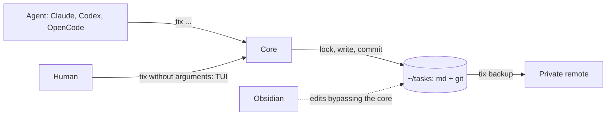
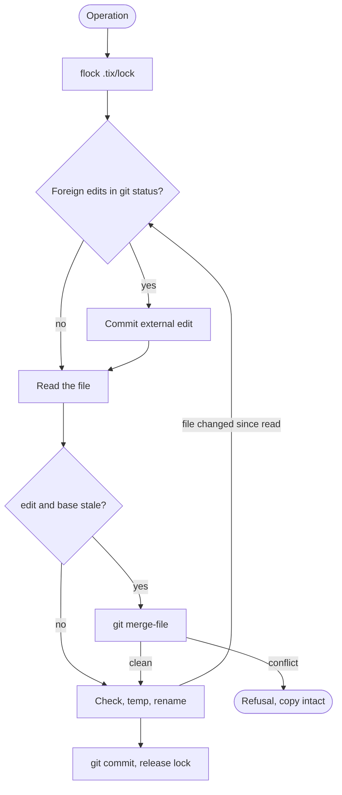

# Spec: tix, an assistant with a task tracker

Status: agreed 2026-10-20, reviews 1-3 passed (history in git)
Canons: `docs/research/landscape.md`, mockup `docs/mockup/ui.html`, after the MVP `docs/specs/integrations.md`

Compiled by the agent on 2026-10-20 from the user's decisions (`docs/specs/decisions.md`). The mark
"proposal" means a technical decision of the agent that the user may cancel. The agent writes all the code.

## Contents

1. Goal and boundaries
2. Architecture
3. Scenarios
4. Data and states
5. Code model
6. Implementation stages
7. Acceptance criterion
8. State model
9. External facts
10. Requirements traceability
11. Text samples
12. Decisions and questions
13. Slicing
14. Access and readiness

## 1. Goal and boundaries

- Goal (D56): memory of agents between sessions and projects. Tasks are md files in `~/tasks` under git,
  and each edit leads to the agent session that made it. One folder for all projects and personal ideas;
  the agent manages tasks through `tix`, the human looks at the board and the cards.
- Principle (D44): a reference standard of speed, lightness and reliability. Each part passes the question "what
  breaks if it is removed"; the answer "nothing" means the part is removed. Numbers - section 7.

| Function | MVP | After MVP | Not doing |
|---|---|---|---|
| Core: md files, lock, commit per edit, merge, pickup of Obsidian edits | yes | | |
| CLI `tix`: 14 commands (2.2) | yes | | |
| TUI `ascii`: board, card with history, `$EDITOR`, move, order, filter, live refresh, mouse and touchpad, key hint line (2.3) | yes | | |
| Pulse on the board row: last note with its age, the `ask` text; column sorting by `due` (2.3) | yes | priority field, filters by date and priority | |
| Work log in the task (`RULES.md`): a note for each decision, question and stage change; the answer to `ask` is written into the task, whoever answers; `summary` is replaced; an outgrown task is closed, the remainder becomes new tasks | yes | "task outgrown" signal, folding of notes in the card | |
| Agent model in history: the `Model:` trailer (2.4) | yes | analytics report: task time, returns, comparison of agents | |
| Columns with roles in `config.toml`; fields `waiting`, `claim`, `due`, `tags`, `ask` | yes | custom fields, theme choice, theme `cards` | |
| Yellow star on `ask` | yes | reply to the agent from the card; colors by kind of need | |
| Connectors for Claude Code, Codex, OpenCode (2.4) | the agent installs one once | `setup` | |
| `RULES.md`, home session in `~/tasks` | yes | | |
| Backup by `git push` to a private remote | by command | in the background | |
| External trackers | `external` as a link | status and result: `tix pull`, key `s` (D61, `docs/specs/integrations.md`) | sync of fields and comments |
| Scheduled assistant, execution time on screen | | yes | |
| Public repository v0.1.0: the whole repository in English, manifest and scenarios in the README, demo, CI, release (D47) | yes | | |
| Column `review`, archive of `done` after 7 days, limit of tasks in progress per project, launching an agent from the board | | v0.2 (D65) | |
| Operations center: launching an agent from a card | | own spec, Galera #165 | in near versions |
| `blocked_by`, `parent` and task links - investigation after the MVP (D65); `tix sync` for two machines (D61), opening the session of an edit, built-in editor, side panel, view in Obsidian Bases | | if needed | |
| `estimate`, `branch`, `links`; editing comments; server, web, several machines; own LLM | | | yes |

## 2. Architecture

Approved by the user on 2026-10-20. Stack: Go, Bubble Tea. One binary `tix`.

| Block | Responsibility |
|---|---|
| core | reading, validation, lock, writing, commit, merge, log |
| CLI | agent commands, one-line reply |
| TUI | board, card, `$EDITOR`, live refresh (`fsnotify`) |
| `RULES.md`, home session | the assistant role and the card rules |

The root is `~/tasks`; `TIX_HOME` overrides it (tests). An error is one line, the exit code is not 0,
details go to `.tix/log`.

### 2.1 Core: the write algorithm

1. Purpose: the only write path for CLI and TUI; protects against loss of edits.
2. Input and output: an operation on a task; a task file and one commit.
3. How it works (proposal):

   1. Lock: `syscall.Flock` on `.tix/lock`, released when the process dies; wait 5 s
      (`TIX_LOCK_TIMEOUT` in tests).
   2. `git status`: edits that bypass the core (Obsidian, manual, a failed previous commit) are committed
      with a message that has the line `T-12: external edit` for each id, `Actor: external`; a file without an id
      (`RULES.md`, `config.toml`, `Untitled.md`) gets the line `external edit: <path>`.
   3. A point operation (field, move, order, checkbox, comment, delete) is applied to the
      current version without a base. `edit` replaces only the body before `## Comments` and carries the base
      `rev`; if it is stale - `git merge-file`.
   4. Write to a temp file, check that the file did not change since the read, rename. If it changed -
      repeat from step 2, up to three times; the window between the check and the rename is an accepted risk.
   5. The commit holds exactly the bytes of the core: `hash-object -w`, `update-index --index-info`, commit of the index
      (`docs/api/git.md`, section 10). A write that bypasses the core after the rename stays in the tree and goes out with the
      next operation as an external edit. Accepted risk S1: a foreign `git add` between
      `update-index` and `commit` goes out under the agent's `Actor:`. If the commit failed, the edit is already in the file, the reply is
      `ok` with a warning, code 0, an entry in the log; the next operation commits it as an external edit.
4. Critical rules:
   - one edit - one commit; the message starts with `T-12:`; trailer `Actor:`; from a project
     folder - trailer `Code: <project>@<sha HEAD>` (D58, S2);
   - git: `-c commit.gpgsign=false -c core.hooksPath=/dev/null -c user.name=tix
     -c user.email=tix@localhost -c gc.auto=0 -c maintenance.auto=false`; garbage collection is our own:
     a write counter and `git gc` in the background (S2, `docs/api/git.md`, section 5); readers use
     `--no-optional-locks`; the git call is replaced in tests;
   - git lock files (D62): `.git/*.lock` and `refs/**/*.lock` older than 10 s are removed under our lock
     with a log entry; if the file is fresh - the reply is `git is busy`, no write is made;
   - `rev` is a git blob id; reading for `edit` and `$EDITOR` writes the blob to git (`hash-object -w`),
     so the merge base always exists, even after an Obsidian edit;
   - `note` is an empty commit; the card history is `git log --grep '^T-12:'`;
   - the core does not overwrite a file that cannot be parsed, it reports the path and the error;
   - frontmatter through `yaml.v3` Node: order and foreign fields are preserved; modification dates come from git;
   - everything after `## Comments` is comments; parsed by the markers `<!-- c: ISO | author -->`;
   - `id` is the counter `.tix/next_id` under the lock, in git; the file name does not change after creation;
   - delete: the file is removed, the path is dropped in the commit of the operation; restore: `git checkout <rev> -- <file>`, the core commits it as an external edit;
   - the first write creates `~/tasks`, git, `config.toml`, `.gitignore` (`.tix/{tmp,lock,log}`,
     `.obsidian/workspace*`, `.trash/`, `*.swp`). Tasks are only `T-*.md`.

### 2.2 CLI

1. Purpose: the agent interface with the minimum of tokens.
2. Input and output: a command; a one-line reply; `--json` only on `ctx`, `list`, `show`.
3. Commands (proposal, sample - the "agent" tab of the mockup):

| Command | What it does |
|---|---|
| `ctx` | rules in brief, columns with roles (`idea=inbox ...`), project tasks in `active`, `waiting`, `ready` (up to 5 per column by `rank`, then "K more"), next task; up to 2000 characters |
| `list`, `show` | list with filters; the whole task, with `rev` |
| `new` | new task, in `inbox` by default |
| `take` | into `active` and `claim`; `--steal` takes over (D39); `--release` drops the claim |
| `move` | move with the checks of 2.5; column by name or by role, name wins; order `--first` or `--after T-9`, the core computes `rank` under the lock |
| `set` | only `title`, `waiting`, `due`, `tags`, `ask`, `external`, `abstract`, `summary` |
| `edit` | body from stdin with `--base <rev>`; does not touch comments; `## Comments` in the new body - refusal |
| `check`, `note`, `comment` | check a criterion; a step into history; a comment |
| `done` | close; the result `-m` goes as the comment "Result: ..."; `--force` (D40) |
| `rm`, `backup` | delete; commit of edits that bypass the core (step 2 of 2.1), then `git push` |

   - `status`, `id`, `created`, `claim`, `rank` change only through their own commands (`move`, `take`,
     `done`); `set` and `edit` do not accept them;
   - project: the name of the folder above `.git` (for a worktree - above the main one), searched in Go without running git; a map
     of names in the config; `--project` overrides; in `~/tasks` - all projects, `new` - project `personal`;
   - a repeated `take` by the same session, `done` of a closed task, a move to the same column - `ok` without
     a commit.
4. Critical rules: the numbers of section 7.

### 2.3 TUI

1. Purpose: the human screen, first of all for viewing.
2. Input and output: keys; one operation queue in the background, the screen is not blocked by the lock.
3. How it works (mockup):
   - ASCII, lines made of hyphens; colors: main, muted, accent; yellow star - your action
     is needed, orange - error;
   - board: number, project, title, first line of the summary, criteria, due date, `claim`, star;
     an unknown column is the column `?`;
   - card: title and column, fields in one line, the `ask` line, abstract, summary, details,
     history: moves, notes, comments are always visible; consecutive other edits by the same
     `Actor` - one line "N edits", `enter` expands it; `external` is a separate author (D60);
   - the human main path without the CLI, by keys and mouse (D66):
     board - arrows, `enter` and double click, grab a card by `space`-arrow-`space` and by drag,
     `n` and `+` new task, `a` reply, `g` agent session, `e`, `c`, `o` due date, `p` project,
     Delete with `y/n`, `?` help, `q`; card - up-down arrows over criteria and history
     (`enter` and click check an item), left-right the neighbor task, `f` field, `esc`.
     The hints of the board and the card are rows of buttons.
4. Critical rules:
   - `$EDITOR` edits a copy of the body in `.tix/tmp/`; unchanged - cancel; changed - `edit` with
     the base that was opened before the editor; conflict - the editor again with markers, the base is the version against
     which the conflict is shown; on any refusal the copy stays, the path is in the error line;
   - a move to `waiting` and `done` with unchecked criteria asks one line at the bottom of the screen:
     what we wait for, or the reason for closing;
   - a panic is caught, the terminal is restored, the error goes to the log.

### 2.4 Agent connectors

1. Purpose: the agent knows the tracker and gets context at start and after the window is compacted.
2. Input and output: files in the agent settings; in the MVP the agent installs them once.
3. How it works (recon 2026-10-20, D49, D54):

| What | Claude Code | Codex | OpenCode |
|---|---|---|---|
| skill `tix` | plugin | `~/.agents/skills/tix` | reads `~/.agents/skills` |
| `tix ctx` by hook | SessionStart, PreCompact (plugin) | SessionStart, approve in `/hooks` | none; the skill tells it to call `ctx` |
| permission | `Bash(tix *)` | `prefix_rule` in `~/.codex/rules/default.rules` | `permission.bash` |

4. Critical rules:
   - identity (`Actor:` and `claim`) is `agent:session id`, the id is full (D56), in order: `--as`;
     `CLAUDE_CODE_SESSION_ID`, `CODEX_THREAD_ID`; `TIX_ACTOR`; TUI - `human`. With no identity
     `take` refuses with the hint `--as`, the others write `unknown`. OpenCode: the session id - S3;
   - model (D65): the start hook of Claude Code calls `tix ctx --hook`, which writes `TIX_MODEL` to
     `CLAUDE_ENV_FILE` (the value is validated, the shell executes the file); the commit of a write carries the trailer
     `Model:`. Limits until v0.2: a `/model` switch does not update the value, subagents get the model
     of the parent, Codex does not write the trailer;
   - `CLAUDE.md` and `AGENTS.md` are not touched - for the user they are symlinks to one file;
   - Codex takes `tix` out of the sandbox only for a single command, without `;`, `&&`, pipes, `cd`
     (`docs/api/codex.md`).

### 2.5 Columns

The column role tells the program what the column means, regardless of the name (D24). One role is one
column; the agent does not touch a column without a role; a column with tasks cannot be deleted without a move.
A `config.toml` error gives the path and the line.

| Role | Default | Check on move |
|---|---|---|
| `inbox` | idea | - |
| `ready` | todo | at least one criterion; `ctx` takes the next task from here |
| `active` | doing | execution time is counted here |
| `waiting` | blocked | `waiting` is required (D41) |
| `closed` | done | all criteria checked, or `--force -m` (D40) |

## 3. Scenarios

| Scenario | Steps | Result |
|---|---|---|
| Happy path | The hook gave `ctx`; the agent runs `take`, `note`, `check`, `set summary=`, `comment`, `done -m` | The task is in `closed`, the history of steps is in git |
| Idea | The user in the home session: "write down an idea" | A task in `inbox`, project `personal` |
| Two agents, different tasks | They write at the same time | The lock queues the writes |
| Foreign claim | A second session runs `take` | Refusal with the owner and the deadline; `--steal` takes over, the takeover is in history |
| `edit` on an old base | The file managed to change | Merge; conflict - refusal, the agent rereads |
| `$EDITOR` and an agent comment | Different parts of the file | The merge is clean |
| `$EDITOR` and an edit of the same lines | Conflict | The editor again with markers; the copy is intact |
| Edit in Obsidian | The file was changed without the core | The next operation commits it as an external edit |
| `set status=` | An attempt to bypass `move` | Refusal with the hint of the command |
| Closing with unchecked criteria | `done` | Refusal with the list; `--force -m` closes |
| Repeat | The agent repeated a command | `ok` without a commit; a repeated comment is a duplicate |
| Lock busy | Another process is writing | Wait 5 s, error in one line |
| Dangling git lock file | git was killed, the file is older than 10 s | Removed under our lock, log entry (D62) |
| Fresh git lock file | git of another process is working | `git is busy`, no write is made |
| Process killed in the middle of a write | `kill -9` | No half-written files; the next operation commits what was written |
| Broken file or config | Cannot be parsed | The core does not write, shows the path and the line |
| Empty `~/tasks` | Hook `ctx` | One line; the first write creates the folder |
| Remote unavailable | `backup` | Error in one line |

## 4. Data and states

See section 8.

## 5. Code model

- Task: frontmatter `id`, `title`, `project`, `status`, `rank` (fractional), `created`,
  `external`, `waiting`, `claim`, `due`, `tags`, `ask`. Body (D23, D25): `## Abstract`,
  `## Summary` (the first line is on the board), `## Details` (criteria as checkboxes, links),
  `## Comments` (append only).
- `claim`: `actor until ISO`; only `take` checks it; the owner's writes to the file extend it by 3 h
  (`note` does not); it is dropped by `take --release`, `done`, a move out of `active`, expiry (D36, D39).
- History event: commit `T-12: <operation> [text]`, trailers `Actor:` and `Code:` (D58).

## 6. Implementation stages

See section 13.

## 7. Acceptance criterion

The user does not read the code (D33), so acceptance is automatic.

- `make check` in a temporary folder (`TIX_HOME`):
  - core tests for the scenarios of section 3; substitution of the git call for "commit failed";
  - race: 5 processes of 20 `comment` each - 100 comments and 100 commits;
  - `kill -9` in the middle of a write: no half-written files, `git fsck` is clean;
  - TUI through `teatest` and a stub `EDITOR`.
- `make bench` before a release, the numbers go to the README; it does not block the task (D64). Targets for 1000 tasks:

| Operation | Target |
|---|---|
| `ctx`, `list`, `show` | up to 15 ms; without Glamour and other libraries with a heavy init (the ASCII theme does not need it) |
| write with commit | up to 50 ms; the first one after an edit that bypassed the core - up to 70 ms (measured 55) |
| TUI open | up to 100 ms |

- `make e2e-agents`: fixture - a task in `ready` with one criterion and one prompt; `claude -p
  --allowedTools "Bash(tix *)"`, `codex exec` with `prefix_rule`, `opencode run`. Pass - commits take,
  note, done with the agent's `Actor:`. It spends subscription limits: at the end of the stage, with the user's consent.
- Not automated: the look of the TUI and Obsidian - the user, by eye; a simultaneous edit in
  Obsidian - the user, once, otherwise an accepted risk.

## 8. State model

| Entity | States and transitions | Frozen | Writer | Storage |
|---|---|---|---|---|
| Task | the columns of the config; a transition between any of them with the checks of 2.5; delete | `id`, `created`, file name | core; Obsidian bypassing it | `~/tasks/T-12 <slug>.md` |
| Comment | created | everything | core | section in the file |
| Note | created | everything | core | empty commit |
| Claim | free; held 3 h with extension; dropped, stolen, expired | - | core | `claim` |
| Config | columns change | five roles | core or human | `.tix/config.toml` |

Agent rights: creates, moves from `inbox` to `ready`, closes, deletes, changes the config.

## 9. External facts

| System | Fact | Source, date | If otherwise |
|---|---|---|---|
| Obsidian | properties are flat; `tags`, `aliases`, `cssclasses` are taken | obsidian.md/help/properties, 2026-10-20 | - |
| Obsidian | merges an external edit with an open buffer; loss of an edit is not confirmed | changelog 0.11.6 | accepted risk |
| git | `merge-file` joins edits in different places; `log -- <file>` skips empty commits | run 2026-10-20; review 1 | - |
| Agents | skills are lazy in all three; start hook in Claude and Codex; `CLAUDE_CODE_SESSION_ID` in the environment | documentation, `env`, 2026-10-20 | OpenCode takes `ctx` through the skill |
| Codex | `.git` is read-only; allow lifts the sandbox for a single `tix`; `CODEX_THREAD_ID` is a UUID | `docs/api/codex.md` | directory `.tixgit` |
| Bubble Tea | v2.1.0; Bubbles v2.2.1; binary start 2.3 ms | releases, measurement 2026-10-20 | - |

## 10. Requirements traceability

There is no customer brief; the requirements are the decisions D1-D62, the tasks are `docs/backlog.md`.

## 11. Text samples

Screens and CLI output - the mockup `docs/mockup/ui.html`. `RULES.md` and the task template are the first task.

## 12. Decisions and questions

User decisions D1-D62 - `docs/specs/decisions.md`.

Open questions (do not block the MVP): Q5 - what counts as execution time; Q7 - what the
scheduled assistant does.

## 13. Slicing

`docs/backlog.md`.

## 14. Access and readiness

| Access | For which tasks | Check | Obtained |
|---|---|---|---|
| Go 1.27.2 | all | `go version` | yes |
| Codex, OpenCode | connectors, e2e | `codex --version`, `opencode --version` | yes |
| private remote (provided by the user) | backup | `git -C ~/tasks remote -v` | no |

The remote is needed only for backup.
