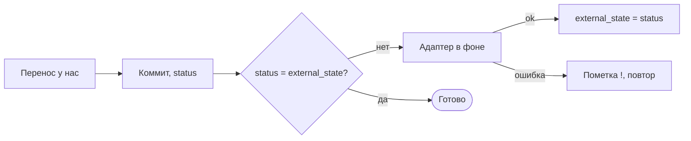

# Спека: синхронизация с внешними трекерами (после MVP)

Статус: draft
Родитель: `docs/spec.md` (решения Р14, Р29-Р32). Макет: вкладка «интеграции» `docs/mockup/ui.html`.

## 1. Цель и границы

- Цель: перенос задачи у нас меняет статус в Kaiten или GitHub; перенос там меняет статус у нас.
- Делаем: статус в обе стороны; итог при `done` комментарием наружу (Р31).
- Не делаем: синхронизацию полей, тела, комментариев и заметок; создание задач снаружи.
- В MVP поле `external` - только ссылка (Р32).

## 2. Как работает (предложение)



1. Человек или агент переносит задачу; ядро меняет `status`, коммит.
2. `external_state` хранит статус, известный внешнему трекеру. Расходится со `status` - задача ждёт
   отправки; отдельной очереди нет.
3. Адаптер в фоне: `kaiten card move <id> --column <колонка>` или
   `gh project item-edit --url <issue> --field Status --value <статус>`; `done` у GitHub закрывает
   issue, выход из `done` открывает.
4. Ok - `external_state` догоняет `status`. Ошибка - пометка `!` на карточке, повтор по `s` и при
   запуске TUI.
5. Входящие изменения: по `s` в TUI, `tk pull` (Р61), старт TUI. Задача у нас не менялась - переносим и
   пишем в историю. Изменилась с обеих сторон - побеждает внешний трекер (Р30), наш перенос
   остаётся в git. 404 - пометка, задачу не трогаем.
6. При `done` итог `-m` уходит комментарием один раз (метка в тексте комментария).

Адаптер - исполняемый файл `tracker-ext-<имя>` в `~/tasks/.tracker/ext/` или в PATH, как
`git-remote-<имя>`. JSON в stdin и stdout; операции `get`, `set_state`, `comment`, `list`. Первые
адаптеры - скрипты поверх установленных `kaiten` и `gh`.

Соответствие колонок в `config.toml`:

```
[adapters.kaiten.columns]
todo = "Очередь"
doing = "В работе"
blocked = "В работе"
done = "Готово"

[adapters.gh]
done = "close"
project = "owner/3"
status = { todo = "Todo", doing = "In Progress", done = "Done" }
```

## 3. Критичные правила

- Соответствие колонок может быть неоднозначным: `doing` и `blocked` обе идут в «В работе».
  Входящий статус, который соответствует текущей колонке задачи, её не меняет; иначе задача
  переходит в первую колонку из соответствия (предложение).
- Ошибка сети не меняет `status`; повтор `set_state` безопасен.
- Изменения снаружи не трогают поля, тело и комментарии.
- Удаление снаружи не удаляет задачу.

## 4. Внешние факты

| Система | Факт | Источник, дата |
|---|---|---|
| Kaiten | `kaiten card move <id> --column`, `card comment`, `--json`; CLI v0.6.1 | `--help`, 20.10.2026 |
| GitHub | `gh project item-edit --url --field --value` по именам; `gh` 2.102 залогинен | `--help`, 20.10.2026 |
| Kaiten | REST, Bearer, 50 запросов в секунду | developers.kaiten.ru |
| GitHub | 5000 запросов в час | docs.github.com |

## 5. Открытые вопросы

- Как часто опрашивать внешние трекеры без действия пользователя: никогда, при старте TUI, по таймеру.
- Задача с `external` удалена у нас: что делать с внешней.
