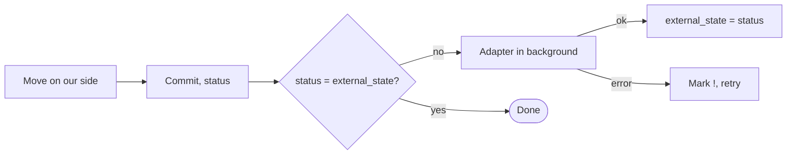

# Spec: sync with external trackers (after the MVP)

Status: draft
Parent: `docs/spec.md` (decisions D14, D29-D32). Mockup: the "integrations" tab of `docs/mockup/ui.html`.

## 1. Goal and boundaries

- Goal: moving a task on our side changes its status in Kaiten or GitHub; moving it there changes the status here.
- We do: status in both directions; the result at `done` as a comment outward (D31).
- We do not do: sync of fields, body, comments and notes; creating tasks from outside.
- In the MVP the field `external` is only a link (D32).

## 2. How it works (proposal)



1. The human or the agent moves a task; the core changes `status`, commit.
2. `external_state` stores the status known to the external tracker. If it differs from `status`, the task waits
   to be sent; there is no separate queue.
3. The adapter in the background: `kaiten card move <id> --column <column>` or
   `gh project item-edit --url <issue> --field Status --value <status>`; for GitHub `done` closes the
   issue, leaving `done` reopens it.
4. Ok - `external_state` catches up with `status`. Error - the mark `!` on the card, a retry on `s` and at
   TUI start.
5. Incoming changes: on `s` in the TUI, `tix pull` (D61), TUI start. The task did not change on our side - we move it and
   write to history. It changed on both sides - the external tracker wins (D30), our move
   stays in git. 404 - a mark, we do not touch the task.
6. At `done` the result `-m` goes out as a comment once (a marker in the comment text).

The adapter is an executable `tix-ext-<name>` in `~/tasks/.tix/ext/` or in PATH, like
`git-remote-<name>`. JSON on stdin and stdout; operations `get`, `set_state`, `comment`, `list`. The first
adapters are scripts on top of the installed `kaiten` and `gh`.

Column mapping in `config.toml`:

```
[adapters.kaiten.columns]
todo = "Queue"
doing = "In progress"
blocked = "In progress"
done = "Done"

[adapters.gh]
done = "close"
project = "owner/3"
status = { todo = "Todo", doing = "In Progress", done = "Done" }
```

## 3. Critical rules

- The column mapping can be ambiguous: `doing` and `blocked` both go to "In progress".
  An incoming status that matches the current column of the task does not change it; otherwise the task
  moves to the first column of the mapping (proposal).
- A network error does not change `status`; a repeated `set_state` is safe.
- Changes from outside do not touch fields, body and comments.
- Deletion from outside does not delete the task.

## 4. External facts

| System | Fact | Source, date |
|---|---|---|
| Kaiten | `kaiten card move <id> --column`, `card comment`, `--json`; CLI v0.6.1 | `--help`, 2026-10-20 |
| GitHub | `gh project item-edit --url --field --value` by names; `gh` 2.102 logged in | `--help`, 2026-10-20 |
| Kaiten | REST, Bearer, 50 requests per second | developers.kaiten.ru |
| GitHub | 5000 requests per hour | docs.github.com |

## 5. Open questions

- How often to poll external trackers without a user action: never, at TUI start, on a timer.
- A task with `external` was deleted on our side: what to do with the external one.
